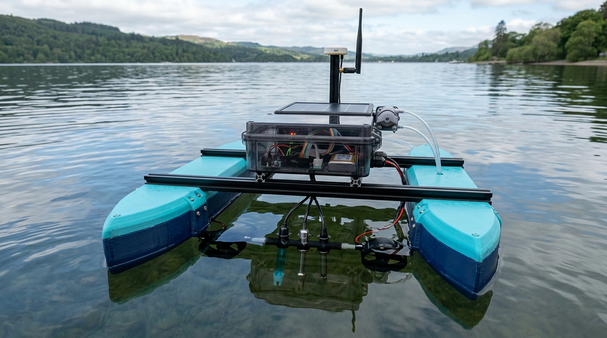
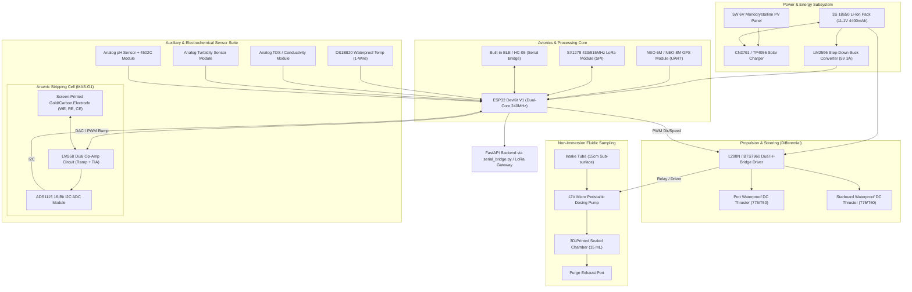

# AquaSentry Autonomous Catamaran Prototype Blueprint
## Open-Hardware Water Surveillance Vessel & Arsenic Stripping Cell

---

### Executive Architecture Overview

The **AquaSentry Autonomous Surface Vessel (ASV)** is a twin-hull catamaran robot engineered to screen lakes, rivers, and community reservoirs for dissolved arsenic ($As^{3+}/As^{5+}$) and geochemical interference parameters (pH, TDS/EC, Turbidity, Temperature). 

To ensure anyone can construct, test, and deploy this vessel without proprietary industrial tooling, **over 90% of the platform utilizes standard, off-the-shelf robotics hobbyist modules**, standard **2020 aluminum extrusions**, and a **desktop 3D printer** for the hull structure.

---

### System Architecture Diagram

---

### Component-by-Component Bill of Materials (BOM)

#### 1. Hull & Mechanical Structure
| Part Name | Role in Robot | Why Chosen / Standard Availability |
| :--- | :--- | :--- |
| **Twin 3D-Printed Pontoons** | Provides buoyancy, hydrodynamic low-drag displacement, and rollover stability during lake chop. | Printable on standard 220×220×250 mm 3D printers in 3 interlocking modular segments (Bow, Mid, Stern). |
| **2020 Aluminum Extrusions** (2x 450mm) | Heavy-duty crossbeams connecting the two pontoons into a rigid catamaran chassis. | Standard 3D printer extrusion; slotted for infinitely adjustable mounting brackets using M4 T-nuts. |
| **IP67 Waterproof Junction Box** (150×200×75mm with clear lid) | Houses the ESP32, motor driver, ADC, and wiring, protecting electronics from lake spray and rain. | Off-the-shelf electrical junction box costing under $6; clear lid allows visual inspection of status LEDs. |
| **Ballast Fin & Weight** (M8/M10 bolts or lead fishing weights) | Mounted to the keel bottom below the center of mass. | Lowers center of gravity to prevent capsize in high winds; self-righting physics. |

#### 2. Propulsion & Steering (Zero-Leak Differential Drive)
| Part Name | Role in Robot | Why Chosen / Standard Availability |
| :--- | :--- | :--- |
| **2x 12V 775 DC Motors + Waterproof Shaft Kits** *(or 2x T60 Underwater Thrusters)* | Submerged stern propellers providing forward, reverse, and differential steering. | Ubiquitous in RC boats and DIY robotics. Avoiding traditional mechanical rudders eliminates rudder shaft seal leaks. |
| **L298N Dual H-Bridge Motor Driver** *(or IBT-2 / BTS7960)* | Drives and modulates speed of both thrusters via PWM from the microcontroller. | Most common motor driver in maker robotics; handles up to 2A continuous per channel with heat sink. |

#### 3. Fluidic Sampling Subsystem (Non-Immersion Cell)
| Part Name | Role in Robot | Why Chosen / Standard Availability |
| :--- | :--- | :--- |
| **12V Micro Peristaltic Dosing Pump** | Draws a precise 15 mL water sample through silicone tubing into the internal analysis chamber, then reverses to purge. | Standard medical/aquarium dosing pump ($7–$10). Self-priming, positive displacement; liquid only touches the tubing (no contamination). |
| **3D-Printed Reaction Well** (with silicone O-ring) | Hermetically sealed 15 mL reaction chamber holding the sample and electrode strip. | Keeps stripping electrodes completely isolated from open-water waves, debris, and biofouling. |
| **Silicone Tubing** (2mm ID / 4mm OD, 1 meter) | Fluid transport from lake intake filter to reaction well and exhaust. | Highly flexible, chemical-resistant, zero leaching. |

#### 4. Sensor Suite & Electrochemical Core
| Part Name | Role in Robot | Why Chosen / Standard Availability |
| :--- | :--- | :--- |
| **Screen-Printed 3-Electrode Strip** *(MAS-G1 / Au-Carbon)* | **[Specialized Component]** Gold working electrode (Au-WE), Ag/AgCl reference (RE), carbon counter (CE) for Anodic Stripping Voltammetry (ASV). | **The only non-standard sensor part.** Screen-printed disposable strips (Metrohm DropSens or HKU MAS-G1) provide repeatable micro-gap voltammetry. |
| **LM358 / MCP6002 Op-Amp Circuit** | Forms the micro-potentiostat: applies deposition potential (-0.8V) and converts stripping nanoamp currents to voltages via Transimpedance Amplification (TIA). | Standard $0.20 operational amplifier. Simple circuit schematic easily assembled on perfboard. |
| **ADS1115 16-Bit I2C ADC Module** | Reads the analog output voltage from the potentiostat circuit with high precision (down to $7.8\ \mu\text{V}$ per LSB). | Built-in Arduino/ESP32 ADCs (10-12 bit with noise) cannot resolve nanoamp arsenic stripping peaks. ADS1115 is standard in maker electronics. |
| **DS18B20 Waterproof Temperature Probe** | Measures surface water temperature in real-time. | Stainless steel probe capsule; temperature dictates electrochemical stripping kinetic rates and feeds the neural classifier. |
| **Analog TDS / Electrical Conductivity Sensor** | Measures dissolved ionic minerals ($\mu\text{S/cm}$). | Standard 5V DFRobot-style conductivity probe; acts as proxy for background ionic interference. |
| **Analog Turbidity Sensor Module** | Measures water clarity / suspended silt in NTU via optical infrared scattering. | Suspended clay particles adsorb arsenic ions; required by AquaNet-V1 neural model. |
| **Analog pH Sensor (E-201-C Probe + 4502C Module)** | Quantifies water acidity ($pH\ 5.5 - 9.5$). | Arsenic speciation ($As^{3+}$ arsenite vs $As^{5+}$ arsenate) is strictly pH-dependent. |

#### 5. Brain, Navigation & Telemetry
| Part Name | Role in Robot | Why Chosen / Standard Availability |
| :--- | :--- | :--- |
| **ESP32 DevKit V1 (30-Pin)** | Primary robot microcontroller running sensor polling, pump sequencing, neural edge inference, and communications. | Dual 240MHz cores, built-in Bluetooth and Wi-Fi, 3.3V logic matching LoRa/GPS, cost < $5. |
| **NEO-6M / NEO-8M GPS Module** | Synchronizes real-time latitude/longitude coordinates to every water reading for spatial mapping. | Standard UART GPS with active ceramic antenna; lock acquisition in under 35 seconds. |
| **SX1278 LoRa Transceiver (433MHz or 915MHz)** | Transmits compressed telemetry packets to a shore station over 2–5 km range. | Zero recurring cellular SIM costs; ideal for remote rural lakes and reservoirs. |

#### 6. Power Distribution
| Part Name | Role in Robot | Why Chosen / Standard Availability |
| :--- | :--- | :--- |
| **3S 18650 Li-Ion Battery Pack** (11.1V, 4400–5200 mAh with BMS) | Provides system power for up to 8–12 hours of active patrol and sampling. | Standard high-density cells; fits cleanly inside the central hull cavity. |
| **LM2596 DC-DC Step-Down Buck Converter** | Steps 11.1V down to regulated 5.0V for logic boards, sensors, and GPS. | High efficiency (up to 92%), adjustable via onboard potentiometer. |
| **5W 6V Monocrystalline Solar Panel + TP4056/CN3791** *(Optional)* | Mounted on deck; trickle charges the battery during sunlight hours. | Extends autonomous mission duration indefinitely in calm tropical conditions. |

---

### 3D Printing Specifications for the Shell

To achieve watertight integrity and buoyancy on a standard hobbyist 3D printer (e.g. Ender 3, Bambu Lab, Prusa MK4):

1. **Filament Selection**:
   * **PETG** (*Recommended*): Excellent layer adhesion, high UV resistance, and completely waterproof when printed with slightly higher temperatures ($240^\circ\text{C}$).
   * **PLA+**: Acceptable if coated externally with a two-part marine epoxy (e.g., XTC-3D or clear marine polyurethane varnish).
2. **Slicer Settings for Waterproofing**:
   * **Perimeters / Wall Line Count**: **4 to 5 walls** (prevents water weeping through microscopic layer seams).
   * **Top/Bottom Solid Layers**: **5 layers minimum**.
   * **Infill Density & Pattern**: **25%–30% Gyroid**. Gyroid infill provides omnidirectional strength and creates buoyant air pockets even if an outer wall sustains damage.
   * **Layer Height**: **0.20 mm** (smoother interlayer bond than 0.28 mm).
3. **Modular Hull Assembly**:
   * Each pontoon measures ~600–700 mm total length, split into 3 segments:
     1. **Bow Section**: Hydrodynamic raked bulbous bow to slice through surface weeds.
     2. **Mid Section**: Contains M4 captive nut slots for mounting the 2020 aluminum crossbars.
     3. **Stern Section**: Recessed bracket to clamp the thruster motor and guide wires.
   * Join the 3 sections using stainless steel M4 threaded rods passing through internal alignment channels, sealed with silicone gasket sealant between mating faces.

---

### Operating Mission Routine (Autonomous Screening Cycle)

1. **Autonomous Waypoint Patrol**:
   * GPS guides the catamaran along predefined survey coordinates using differential thrust.
2. **Station-Keeping & Sample Intake**:
   * Vessel stops at target waypoint.
   * Peristaltic pump runs forward for 8 seconds, drawing 15 mL of raw water into the sealed reaction well.
3. **Multi-Parameter Pre-Scan**:
   * Submerged keel probes record pH, conductivity (EC), turbidity, and temperature.
4. **Anodic Stripping Voltammetry (ASV) Quantification**:
   * Potentiostat applies a deposition potential ($-0.8\text{ V}$) for 60 seconds to pre-concentrate $As^{3+}$ onto the gold working electrode.
   * Potential ramps anodically toward $+0.4\text{ V}$ while measuring stripping oxidation current ($i_p$) at $\sim +0.15\text{ V}$ via the ADS1115.
   * Savitzky-Golay quadratic filtering and baseline subtraction calculate peak net current ($\mu\text{A}$) to determine arsenic concentration ($\text{mg/L}$).
5. **AquaNet-V1 Edge Inference**:
   * ESP32 runs the 5-8-6-4 feed-forward neural forward pass locally in $< 2\text{ ms}$, categorizing risk into Safe, Caution, Unsafe, or Hazardous.
6. **Telemetry Transmission & Purge**:
   * Telemetry string formatted: `AS:0.042,PH:7.2,T:24.5,EC:380,TURB:4.2,LAT:25.61,LON:85.14`
   * Sent via LoRa / Bluetooth to shore receiver and automatically ingested by `bridge/serial_bridge.py`.
   * Peristaltic pump reverses for 8 seconds, purging the reaction well into the stern wake.
   * Catamaran proceeds to next GPS waypoint.
