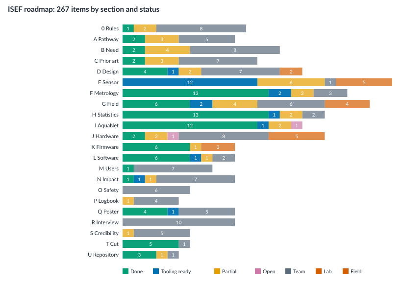

# ISEF roadmap — status of all 267 items

Generated from `Docs/planning/isef_roadmap_status.csv` by `Analysis/roadmap_status.py`; edit the CSV, rerun. The roadmap (`Docs/ISEF_ROADMAP.md`) is the plan; this page says, item by item, what the software has done, what is ready and waiting for the team's data, and - for the team, laboratory and field items - which worksheet, template or calculator in `Docs/TEAM_WORKBOOK.md` carries it. Every item has one of the four statuses; none is unaddressed.

| status | meaning | items |
|---|---|---|
| **Done** | software implemented and tested; nothing left to measure for this item | 57 |
| **Tooling ready** | software exists but has not been run on real samples or hardware; closes when the team's data go through it | 67 |
| **Partial** | software did its part; the rest is the team's | 29 |
| **Worksheet** | team, laboratory or field work with its steps, template or calculator in `Docs/TEAM_WORKBOOK.md` | 114 |
| | **total** | **267** (153 with a software share) |

## By section

| section | items | Done | Tooling ready | Partial | Worksheet |
|---|---|---|---|---|---|
| 0 Rules | 11 | 1 | 0 | 2 | 8 |
| A Pathway | 10 | 2 | 0 | 3 | 5 |
| B Need | 14 | 2 | 0 | 4 | 8 |
| C Prior art | 12 | 1 | 1 | 3 | 7 |
| D Design | 16 | 4 | 4 | 2 | 6 |
| E Sensor | 24 | 0 | 17 | 0 | 7 |
| F Metrology | 20 | 6 | 9 | 2 | 3 |
| G Field | 22 | 2 | 8 | 3 | 9 |
| H Statistics | 18 | 6 | 8 | 2 | 2 |
| I AquaNet | 16 | 8 | 6 | 2 | 0 |
| J Hardware | 18 | 3 | 3 | 2 | 10 |
| K Firmware | 10 | 4 | 4 | 0 | 2 |
| L Software | 10 | 6 | 1 | 1 | 2 |
| M Users | 8 | 1 | 0 | 0 | 7 |
| N Impact | 10 | 1 | 3 | 0 | 6 |
| O Safety | 6 | 0 | 0 | 0 | 6 |
| P Logbook | 5 | 0 | 0 | 1 | 4 |
| Q Poster | 10 | 2 | 3 | 0 | 5 |
| R Interview | 10 | 0 | 0 | 0 | 10 |
| S Credibility | 6 | 0 | 0 | 1 | 5 |
| T Cut | 6 | 5 | 0 | 0 | 1 |
| U Repository | 5 | 3 | 0 | 1 | 1 |

## Every item

### 0 Rules

| # | P | item | owner | status | where / next step |
|---|---|---|---|---|---|
| 1 | P0 | No generative AI for the research plan / abstract / poster / citations | team | **Worksheet** | Rule. Everything in this repository was AI-assisted: use it as notes; write your own documents. Docs/AI_USE_STATEMENT_TEMPLATE.md lists what was AI-assisted so the disclosure is accurate. Workbook §1: Docs/TEAM_WORKBOOK.md. |
| 2 | P0 | Disclose AI use (one-page statement) | team | **Partial** | Docs/AI_USE_STATEMENT_TEMPLATE.md: factual inventory of AI-assisted files, tools and versions; the 'what we checked / designed ourselves' sections are yours to write. Workbook §2. |
| 3 | P0 | Be able to explain every file you show | team | **Worksheet** | Docs/CODE_GUIDE.md walks the code; Docs/DEMO_SCRIPT.md names the 3 screens to show. Rewrite or drop anything you cannot explain. Workbook §3: Docs/TEAM_WORKBOOK.md. |
| 4 | P0 | 12-month rule: research window from Jan 2026 | team | **Worksheet** | Write the start date in the logbook; Docs/planning/timeline.csv has the window; git history dates every software change. Workbook §4: Docs/TEAM_WORKBOOK.md. |
| 5 | P0 | Continuation: Form 7 and 'previous work' labels | team | **Worksheet** | Not software. CHANGELOG.md separates versions by date for the 'what is new this year' table. Workbook §5: Docs/TEAM_WORKBOOK.md. |
| 6 | P0 | Research plan before experimenting; addenda | team | **Worksheet** | Not software. Analysis/run_order.py and Data/field/README.md give the procedures section concrete steps. Workbook §6: Docs/TEAM_WORKBOOK.md. |
| 7 | P0 | SRC review; Form 3 risk assessment; SDS for every chemical | team | **Worksheet** | Not software. See section O. Workbook §7: Docs/TEAM_WORKBOOK.md. |
| 8 | P0 | IRB approval before any survey or interview | team | **Worksheet** | Workbook §8: Docs/TEAM_WORKBOOK.md. |
| 9 | P0 | Team rules (up to 3; fixed for the year) | team | **Worksheet** | Not software. README 'Team' section to be completed (item 267). Workbook §9: Docs/TEAM_WORKBOOK.md. |
| 10 | P0 | Booth must work without electricity or internet | team | **Partial** | Poster figures are SVG/PDF from Analysis/make_poster_figures.py; QR code prints (project_figures.py qr). Print the figures; the dashboard is a bonus. Workbook §10. |
| 11 | P0 | Credit every contribution and library | software | **Done** | Docs/CREDITS.md: libraries (from requirements and the frontend), methods, contributors, data sources; add labs and mentors as they join. |

### A Pathway

| # | P | item | owner | status | where / next step |
|---|---|---|---|---|---|
| 12 | P0 | Confirm IRIS 2026-27 submission status | team | **Worksheet** | Not software. Record the answer in the logbook. Workbook §12: Docs/TEAM_WORKBOOK.md. |
| 13 | P0 | All real dates in one calendar | team | **Partial** | Docs/planning/timeline.csv seeded with the published dates; Analysis/project_figures.py gantt draws it. Confirm the IRIS dates on iris.exstemplar.com. Workbook §13. |
| 14 | P1 | Enter Stockholm Junior Water Prize India | team | **Worksheet** | Workbook §14: Docs/TEAM_WORKBOOK.md. |
| 15 | P1 | Pick the ISEF category on purpose | team | **Worksheet** | Not software (ENEV recommended by the roadmap). Workbook §15: Docs/TEAM_WORKBOOK.md. |
| 16 | P1 | Work backwards from the fair date | team | **Partial** | Milestones (field data -8 weeks, poster -6 weeks, 3 mocks) are rows in Docs/planning/timeline.csv. Workbook §16. |
| 17 | P1 | Scope freeze date (15 March 2027) | team | **Partial** | Row in timeline.csv. In software: tag the frozen version (git tag isef-2027, item 265). Workbook §17. |
| 18 | P2 | Travel documents early | team | **Worksheet** | Row in timeline.csv. Workbook §18: Docs/TEAM_WORKBOOK.md. |
| 19 | P2 | Two reviews with a statistics mentor | team | **Worksheet** | Row in timeline.csv; Analysis/*/report.md are what to review. Workbook §19: Docs/TEAM_WORKBOOK.md. |
| 20 | P2 | Decision log | software | **Done** | Docs/DECISION_LOG.md seeded with the dated software decisions; add yours. |
| 21 | P2 | One-page Gantt chart | software | **Done** | Analysis/project_figures.py gantt -> gantt.svg from Docs/planning/timeline.csv. |

### B Need

| # | P | item | owner | status | where / next step |
|---|---|---|---|---|---|
| 22 | P0 | One sentence of need with a number and source | team | **Worksheet** | Write it yourself from JJM / CGWB; cite the year. Workbook §22: Docs/TEAM_WORKBOOK.md. |
| 23 | P0 | State who the primary user is | team | **Worksheet** | Not software. The platform supports district-lab, panchayat and household views; pick one for the story. Workbook §23: Docs/TEAM_WORKBOOK.md. |
| 24 | P0 | Design criteria as measurable targets | team | **Partial** | Docs/REQUIREMENTS_TRACEABILITY.md lists each criterion with the test that proves it and the current result/target. Workbook §24. |
| 25 | P0 | Constraints written down | team | **Partial** | Docs/REQUIREMENTS_TRACEABILITY.md 'Constraints' section (power, network, languages, hard water, iron/manganese, temperature) with what the software does about each. Workbook §25. |
| 26 | P0 | Why current options fail the criteria (comparison table) | team | **Partial** | Data/field/landscape_template.csv + project_figures.py landscape give the figure once the numbers are filled from datasheets. Workbook §26. |
| 27 | P1 | Quantify the gap (time to lab result; retest frequency) | team | **Worksheet** | Not software. The paired export's pair_gap_hours measures it for your own samples. Workbook §27: Docs/TEAM_WORKBOOK.md. |
| 28 | P1 | Why continuous monitoring matters (seasonal change) | team | **Worksheet** | Not software; the trend endpoint (Mann-Kendall) shows it on real data later. Workbook §28: Docs/TEAM_WORKBOOK.md. |
| 29 | P1 | Health end point in plain words | team | **Worksheet** | Workbook §29: Docs/TEAM_WORKBOOK.md. |
| 30 | P1 | Legal limits stated correctly | software | **Done** | app/standards.py; dashboard, PDF, chatbot: IS 10500 Amendment 1 (2015) 10 µg/L no relaxation; WHO 10 µg/L (v5.2, v5.7). |
| 31 | P1 | One testable research question | team | **Worksheet** | Not software. Analysis/paired_validation.py computes the sensitivity it asks about. Workbook §31: Docs/TEAM_WORKBOOK.md. |
| 32 | P2 | Map of affected habitations next to test sites | team | **Partial** | Dashboard map shows tested sites; the affected-habitation layer needs the government source (item 49). Workbook §32. |
| 33 | P2 | One stakeholder quote | team | **Worksheet** | Workbook §33: Docs/TEAM_WORKBOOK.md. |
| 34 | P2 | Avoid 'AI-powered' as the problem statement | software | **Done** | No 'AI-powered' / 'revolutionary' / '100 % accurate' wording anywhere in the dashboard, docs or chatbot prompt (checked by grep in v5.9). |
| 35 | P2 | Why arsenic first and where the design extends | team | **Worksheet** | Workbook §35: Docs/TEAM_WORKBOOK.md. |

### C Prior art

| # | P | item | owner | status | where / next step |
|---|---|---|---|---|---|
| 36 | P0 | Literature review (20+ papers; table) | team | **Worksheet** | Not software. Keep the table as a CSV (method, LOD, interferents, cost, field-tested) next to Data/field/landscape_template.csv so the landscape figure draws from it. Workbook §36: Docs/TEAM_WORKBOOK.md. |
| 37 | P0 | One sentence of what is new | team | **Worksheet** | Not software; Docs/CLAIMS_REGISTER.md shows what is and is not demonstrated. Workbook §37: Docs/TEAM_WORKBOOK.md. |
| 38 | P1 | Compare with open-source and commercial potentiostats | team | **Partial** | Rows for Bullen et al. and commercial instruments in landscape_template.csv; fill the numbers. Workbook §38. |
| 39 | P1 | Past ISEF projects on arsenic / water sensing | team | **Worksheet** | Workbook §39: Docs/TEAM_WORKBOOK.md. |
| 40 | P1 | Patent search | team | **Worksheet** | Workbook §40: Docs/TEAM_WORKBOOK.md. |
| 41 | P1 | Cite the Indian field-testing ecosystem (JJM kits; WQMIS; NABL) | team | **Partial** | JJM/WQMIS export exists (GET /api/data/export/jjm); cite the documents yourself. Workbook §41. |
| 42 | P2 | Earlier Indian student / startup efforts | team | **Worksheet** | Workbook §42: Docs/TEAM_WORKBOOK.md. |
| 43 | P2 | BibTeX/Zotero library; one citation style | team | **Worksheet** | Workbook §43: Docs/TEAM_WORKBOOK.md. |
| 44 | P2 | Cite WHO and BIS documents directly | team | **Partial** | Docs/IMPROVEMENT_LOG.md and app/standards.py cite the documents used by the code; cite them in your paper. Workbook §44. |
| 45 | P2 | Note reused code/designs and licences | software | **Done** | Docs/CREDITS.md. |
| 46 | P2 | List what you deliberately did not do | team | **Worksheet** | Not software (Docs/DECISION_LOG.md has a place for it). Workbook §46: Docs/TEAM_WORKBOOK.md. |
| 47 | P2 | Landscape figure: cost vs LOD | software | **Tooling ready** | Analysis/project_figures.py landscape from Data/field/landscape_template.csv (numbers to fill). Counts as done only once real samples or hardware have gone through it. |

### D Design

| # | P | item | owner | status | where / next step |
|---|---|---|---|---|---|
| 48 | P0 | Alternatives considered with decision matrices | software | **Tooling ready** | Analysis/decision_matrix.py (weighted scores + ±30 % weight-sensitivity) from Docs/templates/decision_matrix_template.csv; reasons in Docs/DECISION_LOG.md. Workbook §48. |
| 49 | P0 | Weighted criteria and scores per matrix | software | **Tooling ready** | Same script: normalised weights, ranking, robustness of the winner. Workbook §49. |
| 50 | P0 | Design-history figure (v1 -> v5.x) | software | **Done** | Analysis/project_figures.py history -> design_history.svg from Docs/planning/design_history.csv (seeded from CHANGELOG). |
| 51 | P1 | Separate chemistry / instrument / system | team | **Partial** | Docs/REQUIREMENTS_TRACEABILITY.md and ROADMAP_COVERAGE.md are organised by those three layers; use the same split on the poster. Workbook §51. |
| 52 | P1 | Block diagram of the instrument with part numbers | team | **Partial** | Firmware/PINOUT.md gives every pin and part; draw the block diagram from it. Workbook §52. |
| 53 | P1 | Failure-mode table (FMEA) | software | **Done** | Docs/FMEA.md: each failure mode, how the device/software detects it, what it reports, which test proves it. |
| 54 | P1 | Requirements traceability table | software | **Done** | Docs/REQUIREMENTS_TRACEABILITY.md. |
| 55 | P1 | Choose one competition prototype | team | **Worksheet** | Not software (recommendation recorded in CLAIMS_REGISTER S6). Workbook §55: Docs/TEAM_WORKBOOK.md. |
| 56 | P1 | Design rationale for sample well and pump volumes | lab | **Worksheet** | Measure dead volume, fill and rinse volumes; Docs/templates/carryover_holdtime_sheet.csv. Workbook §56. |
| 57 | P1 | Justify electrode choice with own measurements | lab | **Tooling ready** | Analysis/electrode_study.py + decision_matrix.py on your electrode measurements. Workbook §57. |
| 58 | P2 | Bill of materials with prices; cost per test | software | **Tooling ready** | Data/field/bom_template.csv -> Analysis/project_figures.py cost. Workbook §58. |
| 59 | P2 | Design for manufacture; assembly time | team | **Worksheet** | Workbook §59: Docs/TEAM_WORKBOOK.md. |
| 60 | P2 | What you'd change for a production unit | team | **Worksheet** | Workbook §60: Docs/TEAM_WORKBOOK.md. |
| 61 | P2 | Safety-by-design choices written down | software | **Done** | Docs/FMEA.md 'Safety by design' section (software and electrical parts); add the chemistry parts. |
| 62 | P2 | Exploded view of the enclosure | team | **Worksheet** | Not software (STL files in models_3d/). Workbook §62: Docs/TEAM_WORKBOOK.md. |
| 63 | P2 | Keep the old prototypes | team | **Worksheet** | Workbook §63: Docs/TEAM_WORKBOOK.md. |

### E Sensor

| # | P | item | owner | status | where / next step |
|---|---|---|---|---|---|
| 64 | P0 | Get the LOD below 10 µg/L | lab | **Worksheet** | Not software. The platform reads LOD from the calibration record and never claims below the validated LOD (v5.8 floor). Workbook §64: Docs/TEAM_WORKBOOK.md. |
| 65 | P0 | Measure LOD and LOQ properly (>= 10 blanks) | lab | **Tooling ready** | Docs/templates/standards_template.csv (>= 10 blanks, 6 standards) -> Analysis/linearity.py: LOD 3.3 s/slope from residual and blank SD, LOQ, lack-of-fit. Workbook §65. |
| 66 | P0 | As(III) vs As(V) pre-reduction and recovery | lab | **Tooling ready** | spike_recovery QC runs for As(V) recovery with/without pre-reduction; arsenic_species per reading. Chemistry with the supervisor. Workbook §66. |
| 67 | P0 | Copper interference measured and mitigated | lab | **Tooling ready** | Analysis/interference.py (recovery vs Cu with CI); robust baseline + secondary-peak flag in the pipeline (v5.8). Measurement is lab work. |
| 68 | P1 | Other interferents (Fe, Mn, phosphate, silicate, humics, chloride, hardness) | lab | **Tooling ready** | Analysis/interference.py takes any interferent. |
| 69 | P1 | pH and temperature effects and corrections | lab | **Tooling ready** | Analysis/interference.py with pH / temperature as the x variable (Docs/templates/interference_template.csv). Workbook §69. |
| 70 | P1 | Electrode lifetime (scans until slope drops 10 %) | lab | **Tooling ready** | Docs/templates/electrode_log_template.csv -> Analysis/electrode_study.py: scans to -10 %, drift per 100 scans. Workbook §70. |
| 71 | P1 | Electrode-to-electrode variability (>= 5 electrodes; 2 lots) | lab | **Tooling ready** | electrode_study.py: slope per electrode, CV across electrodes, lot comparison (F ratio); paired_validation by lot. Workbook §71. |
| 72 | P1 | Repeatability and intermediate precision | lab | **Tooling ready** | electrode_study.py repeatability (within session) and intermediate precision (across sessions/operators); paired_validation replicate CV. Workbook §72. |
| 73 | P1 | Linearity with >= 6 standards and residual plot | lab | **Tooling ready** | Analysis/linearity.py: >= 6 standards, residual plot, pure-error lack-of-fit test. Workbook §73. |
| 74 | P1 | Explain the electrochemistry on a poster panel | team | **Worksheet** | Not software (Docs/IMPROVEMENT_LOG.md §4 has the method text to start from). Workbook §74: Docs/TEAM_WORKBOOK.md. |
| 75 | P1 | Raw voltammograms for blank / 10 / 50 / 100 on one plot | software | **Tooling ready** | Every scan is stored (v5.8) and GET /api/scans/{id} returns raw, smoothed and baseline arrays; the dashboard shows the trace. Real scans needed. |
| 76 | P1 | Validate peak finding against >= 50 hand-measured scans | software | **Tooling ready** | Analysis/peak_check.py (v5.9): bias, limits of agreement, Deming slope, worst disagreements. |
| 77 | P1 | Matrix effects: real water vs DI slopes | lab | **Tooling ready** | Standard-addition endpoint per device; spike_recovery QC; paired_validation 'By site'. |
| 78 | P1 | External calibration vs standard addition against ICP-MS | lab | **Tooling ready** | Both calibration types are stored with IDs; reprocess any stored scan with either (v5.8) and compare in paired_validation. |
| 79 | P1 | Dissolved oxygen effect | lab | **Worksheet** | interference_template.csv with dissolved oxygen as the interferent; dissolved_oxygen_mg_l field. Workbook §79. |
| 80 | P2 | Cheaper electrode comparison | lab | **Tooling ready** | electrode_log by electrode_lot -> electrode_study.py; decision_matrix.py. Workbook §80. |
| 81 | P2 | Electrode surface characterisation | lab | **Worksheet** | Microscope photos before/after N scans; photo_log.csv; HARDWARE_CHANGELOG. Workbook §81. |
| 82 | P2 | Sample stability / hold time | lab | **Tooling ready** | carryover_holdtime_sheet.csv hold_time rows; SampleMeta.collection_to_analysis_min stored. Workbook §82. |
| 83 | P2 | Reagent consumption and waste per test | lab | **Worksheet** | Measured volumes into bom_template.csv reagent rows and the safety panel. Workbook §83. |
| 84 | P2 | Potentiostat noise floor with a dummy cell | lab | **Worksheet** | Dummy-cell scan through /api/scans; noise_sigma_ua recorded per scan. Workbook §84. |
| 85 | P2 | Speciation as an extension | team | **Worksheet** | Docs/templates/future_work_template.md. Workbook §85. |
| 86 | P2 | SWASV parameter DoE (2^3 factorial) | lab | **Tooling ready** | Analysis/doe_factorial.py --plan (randomised 2^k plan) and analysis (effects, 95 % CIs, Pareto). Workbook §86. |
| 87 | P2 | Peak current vs deposition time plot | lab | **Tooling ready** | linearity.py deposition_s column -> peak vs deposition time per standard. Workbook §87. |

### F Metrology

| # | P | item | owner | status | where / next step |
|---|---|---|---|---|---|
| 88 | P0 | Certified reference material and recovery % | lab | **Tooling ready** | check_standard QC runs with a CRM; recovery in the QC log and control chart. Workbook §88. |
| 89 | P0 | Blanks with every batch | software | **Tooling ready** | POST /api/qc/runs blank and field_blank (v5.7/v5.9); low readings are gated on recent blanks. Counts as done only once real samples or hardware have gone through it. |
| 90 | P0 | 10 µg/L check standard start and end of each field day; reject if > 20 % drift | software | **Tooling ready** | v5.7 check-standard gate (80-120 %); Analysis/control_chart.py (v5.9) shows drift before it fails a day; run_order.py puts the opening and closing checks on every sheet. Counts as done only once real samples or hardware have gone through it. |
| 91 | P0 | Spike recovery on real samples (80-120 %) | software | **Tooling ready** | spike_recovery QC run type (v5.9) with baseline and recovery %. Counts as done only once real samples or hardware have gone through it. |
| 92 | P1 | Record every calibration; print the ID on each result | software | **Done** | Calibration records (v5.6); calibration ID on the PDF, public page and exports (v5.7-v5.9). |
| 93 | P1 | Measurement uncertainty shown as ± | software | **Done** | ± U (k = 2) per reading (v5.8); the 5 % calibration term is assumed until replicates give a measured value. |
| 94 | P1 | Decision rule with a guard band | software | **Done** | screening_outcome: retest when the interval crosses the detection limit (v5.8). |
| 95 | P1 | Blind samples | software | **Tooling ready** | Analysis/run_order.py: coded run sheet for the operator, sealed key for the supervisor (v5.9). Counts as done only once real samples or hardware have gone through it. |
| 96 | P1 | Randomise run order | software | **Tooling ready** | run_order.py (seeded shuffle; opening and closing checks fixed). Counts as done only once real samples or hardware have gone through it. |
| 97 | P1 | Written cleaning protocol | team | **Worksheet** | Not software; Docs/SOP_MEASUREMENT.md has the slot. Workbook §97: Docs/TEAM_WORKBOOK.md. |
| 98 | P1 | Calibrate pH / EC / temperature / turbidity sensors or drop them from claims | software | **Tooling ready** | QC run types ph_buffer, conductivity_standard, turbidity_standard, temperature_reference (v5.9); /api/qc/status reports sensor_checks.verified per sensor. Counts as done only once real samples or hardware have gone through it. |
| 99 | P2 | Shewhart control charts for the check standard | software | **Tooling ready** | Analysis/control_chart.py (v5.9) with Western Electric rules. Counts as done only once real samples or hardware have gone through it. |
| 100 | P2 | Inter-device comparison | lab | **Tooling ready** | Same sample_code on readings from 2-3 devices; paired_validation groups by device via the site table. |
| 101 | P2 | Store every raw scan with metadata | software | **Done** | RawVoltammetryTrace with checksum, calibration, firmware, analysis version, electrode lot, sample code (v5.8). |
| 102 | P2 | SOP for a measurement | software | **Partial** | Docs/SOP_MEASUREMENT.md: instrument and software steps written; chemistry steps are placeholders for the supervisor. Workbook §102. |
| 103 | P2 | Independent person repeats the SOP | team | **Worksheet** | Workbook §103: Docs/TEAM_WORKBOOK.md. |
| 104 | P2 | Track electrode lots; report per lot | software | **Done** | electrode_lot on readings and scans; paired_validation 'By electrode lot' (v5.9). |
| 105 | P2 | Balance and pipette calibration checks | team | **Worksheet** | Not software (logbook). Workbook §105: Docs/TEAM_WORKBOOK.md. |
| 106 | P2 | Show what happens without the controls | lab | **Partial** | Reprocess stored scans with another calibration (v5.8) shows the calibration control; temperature correction needs item 69 first. Workbook §106. |
| 107 | P2 | Units consistent (µg/L) | software | **Done** | µg/L everywhere in UI, PDF and exports (v5.8 review item 43). |

### G Field

| # | P | item | owner | status | where / next step |
|---|---|---|---|---|---|
| 108 | P0 | Replace simulated data with >= 40 real samples / 15 sources / 2 districts | field | **Tooling ready** | Data/field/README.md + paired_template.csv; /api/scans; bridge --file; GET /api/data/export/paired. Needs the field programme. |
| 109 | P0 | Pre-register the analysis | team | **Partial** | The analysis is fixed in code: paired_validation.py (end points, cutoffs, statistics). Write the pre-registration in the logbook citing the script version (git commit). Workbook §109. |
| 110 | P0 | Confusion matrix at 10 and 50 µg/L with Wilson CIs; missed unsafe count | software | **Tooling ready** | paired_validation.py cutoffs 10 / 20 / 50 (v5.9) with Wilson intervals and missed-unsafe counts; /api/validation endpoint (v5.6). Counts as done only once real samples or hardware have gone through it. |
| 111 | P0 | Proper sample collection; split; chain of custody | software | **Tooling ready** | SampleMeta (purge, bottle, preservation, custody note, split_for_lab, collected_at) stored with readings/scans and exported (v5.9). Procedure in Data/field/README.md. Counts as done only once real samples or hardware have gone through it. |
| 112 | P0 | Record GPS / source type / depth / date-time per sample | software | **Tooling ready** | Device site (lat/long) + SampleMeta source_kind, depth_m, collected_at (v5.9). Counts as done only once real samples or hardware have gone through it. |
| 113 | P1 | Sample set covers the range | field | **Worksheet** | Not software; paired_validation reports the distribution so gaps are visible. Workbook §113: Docs/TEAM_WORKBOOK.md. |
| 114 | P1 | 30-day continuous deployment with weekly lab samples | field | **Tooling ready** | Firmware + Analysis/deployment_report.py on GET /api/data/export (uptime, gaps, late deliveries, QC, outcomes, battery). Workbook §114. |
| 115 | P1 | Report uptime / missed readings / battery / false alarms | software | **Done** | Analysis/deployment_report.py (v5.10): expected vs received, uptime %, longest gap, late deliveries, QC and outcome counts, battery slope, unrepeated positives. Workbook §115. |
| 116 | P1 | Multiple conditions (hot/cold, turbidity, iron, operators, rain) | field | **Worksheet** | Not software; SampleMeta.collector and the sensors record the conditions. Workbook §116: Docs/TEAM_WORKBOOK.md. |
| 117 | P1 | Compare with the government field test kit | field | **Worksheet** | Not software; add a kit_result column to the paired CSV for the comparison. Workbook §117: Docs/TEAM_WORKBOOK.md. |
| 118 | P1 | Repeat sources in a second season | field | **Worksheet** | Not software; readings are timestamped and the trend endpoint shows change. Workbook §118: Docs/TEAM_WORKBOOK.md. |
| 119 | P1 | Photograph every site | team | **Worksheet** | Workbook §119: Docs/TEAM_WORKBOOK.md. |
| 120 | P1 | Letter from the lab | team | **Worksheet** | Workbook §120: Docs/TEAM_WORKBOOK.md. |
| 121 | P1 | Budget the lab costs | team | **Worksheet** | Workbook §121: Docs/TEAM_WORKBOOK.md. |
| 122 | P2 | Share results back with owners and the district lab | software | **Tooling ready** | QR public page per source (v5.6), PDF certificate, JJM export. Counts as done only once real samples or hardware have gone through it. |
| 123 | P2 | Responsible communication plan for a high result | team | **Worksheet** | Not software; alert channels exist and are off by default for practice data. Workbook §123: Docs/TEAM_WORKBOOK.md. |
| 124 | P2 | Use the JJM export | software | **Done** | GET /api/data/export/jjm (v5.6). |
| 125 | P2 | Time per test measured with a stopwatch | software | **Partial** | Firmware prints time to first result (v5.9) and the scan duration is in scan settings; the hands-on part is a stopwatch. Workbook §125. |
| 126 | P2 | Cost actually spent per sample | team | **Tooling ready** | scale_estimate.py rows field_samples_collected / field_total_spend_inr. Workbook §126. |
| 127 | P2 | Keep odd samples for retest | software | **Partial** | The retest outcome flags them; sample_code links the retest to the original. Workbook §127. |
| 128 | P2 | Usability trial with a non-expert | team | **Worksheet** | Not software (IRB). Workbook §128: Docs/TEAM_WORKBOOK.md. |
| 129 | P2 | Map the field results and screenshot for the poster | software | **Tooling ready** | Dashboard map (v5.6); demo data has no coordinates so only real sites appear (v5.7). |

### H Statistics

| # | P | item | owner | status | where / next step |
|---|---|---|---|---|---|
| 130 | P0 | Scatter with 1:1 line and Bland-Altman | software | **Tooling ready** | paired_validation.py (v5.8). Counts as done only once real samples or hardware have gone through it. |
| 131 | P0 | Regression slope/intercept with CIs (Deming) | software | **Tooling ready** | paired_validation.py Deming with bootstrap CIs (v5.8). Counts as done only once real samples or hardware have gone through it. |
| 132 | P0 | Justify the sample size (CI width) | software | **Tooling ready** | paired_validation.py sample-size table (v5.9): Wilson CI width vs n unsafe. Counts as done only once real samples or hardware have gone through it. |
| 133 | P1 | ROC curve and threshold choice | software | **Tooling ready** | paired_validation.py ROC/AUC at 10 / 20 / 50; aquanet_v2_pipeline referral curve. Counts as done only once real samples or hardware have gone through it. |
| 134 | P1 | Precision as CV % at low / medium / high | software | **Tooling ready** | paired_validation.py replicate CV by band (v5.9). Counts as done only once real samples or hardware have gone through it. |
| 135 | P1 | Handle values below LOD as censored | software | **Done** | Censored lab results kept with qualifier (v5.8); Mann-Kendall censors at LOD (v5.4); paired_validation never substitutes zeros. |
| 136 | P1 | Uncertainty for every number on the poster | software | **Tooling ready** | Every metric in the analysis reports carries an interval and n. Counts as done only once real samples or hardware have gone through it. |
| 137 | P1 | Significance tests only with a hypothesis | software | **Done** | The scripts report effect sizes and intervals; interference.py tests the one hypothesis (slope ≠ 0). |
| 138 | P1 | Reproducible analysis script | software | **Done** | Analysis/make_poster_figures.py regenerates every figure from the raw files (v5.9). |
| 139 | P1 | Interference by regression with CI | software | **Tooling ready** | Analysis/interference.py (v5.9). Counts as done only once real samples or hardware have gone through it. |
| 140 | P1 | Explain outliers individually | software | **Partial** | paired_validation and peak_check list the largest disagreements; the explanation goes in the logbook. Workbook §140. |
| 141 | P2 | Power / sample-size estimate for a larger study | software | **Done** | paired_validation.py sample-size table includes 100 and 200 unsafe samples. |
| 142 | P2 | Mixed model for repeated readings per source | software | **Partial** | Grouped-by-site evaluation in aquanet_v2_pipeline avoids the independence error; a mixed model is future work once there are repeated visits. Workbook §142. |
| 143 | P2 | Trend detection on the 30-day deployment | software | **Tooling ready** | Mann-Kendall + Sen slope endpoint (v5.4) needs the real deployment. |
| 144 | P2 | Check the analysis with a statistics teacher | team | **Worksheet** | Workbook §144: Docs/TEAM_WORKBOOK.md. |
| 145 | P2 | No 3D / pie / dual-axis charts | software | **Done** | svg_plots.py draws none of these. |
| 146 | P2 | Colour-blind safe figures readable from 1.5 m | software | **Done** | Okabe-Ito palette, 12-15 px labels in svg_plots.py (v5.9). |
| 147 | P2 | Raw data in a public repository with a DOI | team | **Worksheet** | Not software; Data/field/README.md says what to deposit. Workbook §147: Docs/TEAM_WORKBOOK.md. |

### I AquaNet

| # | P | item | owner | status | where / next step |
|---|---|---|---|---|---|
| 148 | P0 | Be honest that V3 was trained on simulated readings; evaluate on real data | software | **Tooling ready** | Docs/CLAIMS_REGISTER.md N1; Analysis/aquanet_v3_field_eval.py (v5.9) evaluates the deployed network on paired rows. Counts as done only once real samples or hardware have gone through it. |
| 149 | P0 | Baseline: threshold rule and logistic regression | software | **Tooling ready** | aquanet_v3_field_eval.py reports both baselines on the same rows. Counts as done only once real samples or hardware have gone through it. |
| 150 | P0 | Confusion matrix on held-out real data | software | **Tooling ready** | aquanet_v3_field_eval.py; needs the paired dataset. |
| 151 | P1 | Why a network at all | software | **Partial** | The ablation in aquanet_v3_field_eval.py answers it with data; the argument is yours to write. Workbook §151. |
| 152 | P1 | Feature importance / ablation | software | **Tooling ready** | aquanet_v3_field_eval.py ablation table. Counts as done only once real samples or hardware have gone through it. |
| 153 | P1 | Calibration / reliability diagram | software | **Tooling ready** | aquanet_v3_field_eval.py reliability.svg + ECE; aquanet_v2_pipeline reliability. Counts as done only once real samples or hardware have gone through it. |
| 154 | P1 | Hard safety rule can never be overridden to safe; test | software | **Done** | tests/test_aquanet_v3.py, test_ui_safety_gates.py; checked again on every real row by aquanet_v3_field_eval.py. |
| 155 | P1 | Parameter count / memory / inference time measured | software | **Done** | 352 parameters and 1 408 bytes counted from the weight file (field_eval); inference time measured by the firmware boot self-test (v5.8) - record it from a real board. |
| 156 | P1 | Document the training-data generation | software | **Partial** | Docs/neural/AQUANET_V3_REPORT.md and scripts/train_aquanet_v2.py describe the distributions and noise; the 'why realistic' citation is yours. Workbook §156. |
| 157 | P2 | Tiny CNN on raw voltammograms | software | **Done** | aquanet_v2_pipeline.py TraceCNN (numpy 1-D conv on raw voltammograms resampled to the 121-point grid; grouped CV; kept only if it beats the line); GET /api/scans/export feeds it (--scans). Runs on the demo today. |
| 158 | P2 | INT8 vs float accuracy | software | **Done** | Parity tests between the Python, JS and C engines (v5.2+). |
| 159 | P2 | Cross-validation not one split | software | **Done** | Leave-one-site-out in aquanet_v2_pipeline.py and aquanet_v3_field_eval.py. |
| 160 | P2 | Describe the failure cases | software | **Tooling ready** | aquanet_v3_field_eval.py lists the rows the network gets wrong. Counts as done only once real samples or hardware have gone through it. |
| 161 | P2 | Version the model; record it per result | software | **Done** | model_version stored per reading (v5.5) and printed on the certificate 'Versions' line (v5.9). |
| 162 | P2 | Drop 'AI' wording unless the network matters | software | **Done** | No 'AI-powered' wording; 'AquaNet model' is one nav item among the science screens. |
| 163 | P2 | Keep the chatbot out of the main pitch | software | **Done** | Judging mode hides the assistant (v5.9). |

### J Hardware

| # | P | item | owner | status | where / next step |
|---|---|---|---|---|---|
| 164 | P0 | Working robust prototype with a dummy cell at the fair | team | **Worksheet** | Workbook §164: Docs/TEAM_WORKBOOK.md. |
| 165 | P0 | Power consumption per mode; battery life | lab | **Tooling ready** | Docs/templates/power_log_template.csv -> Analysis/power_budget.py: mAh/day, battery life, share by mode. Workbook §165. |
| 166 | P1 | Characterise the potentiostat | lab | **Worksheet** | Dummy-cell noise, linearity vs resistors, step response; tune QC_REF_* thresholds. Workbook §166. |
| 167 | P1 | Pump and fluidics tests; carry-over | lab | **Worksheet** | carryover_holdtime_sheet.csv carryover rows; field_blank QC runs. Workbook §167. |
| 168 | P1 | Enclosure IP / UV / heat tests | lab | **Worksheet** | Docs/templates/enclosure_test_log.csv. Workbook §168. |
| 169 | P1 | Drop / vibration test | lab | **Worksheet** | enclosure_test_log.csv drop/vibration rows. Workbook §169. |
| 170 | P1 | PCB or neat perfboard; wiring diagram; labelled photo | team | **Partial** | Firmware/PINOUT.md gives the wiring table to draw from. Workbook §170. |
| 171 | P1 | Solar sizing with real insolation data | team | **Tooling ready** | power_budget.py --sun-hours (worst-month peak-sun hours) -> panel W and battery for autonomy. Workbook §171. |
| 172 | P1 | Tool-free electrode replacement | team | **Worksheet** | Workbook §172: Docs/TEAM_WORKBOOK.md. |
| 173 | P2 | Custom PCB (KiCad) | team | **Worksheet** | Workbook §173: Docs/TEAM_WORKBOOK.md. |
| 174 | P2 | Reference-electrode open-circuit self-test | firmware | **Done** | Firmware 5.10.0: rest-potential settle test before each cycle (QC_REF_* thresholds), REF_UNSTABLE fault bit, rest/drift in /status.json; server + dashboard text. Thresholds to tune from item 166. |
| 175 | P2 | Device UI usable without a phone (LED/buzzer legend) | team | **Partial** | Firmware drives status LED patterns; print the legend on the lid. Workbook §175. |
| 176 | P2 | All pin assignments in one table | software | **Done** | Firmware/PINOUT.md (v5.9) generated from the firmware defines. |
| 177 | P2 | Reduce the cost; cost curve across versions | team | **Tooling ready** | One BOM CSV per hardware version -> project_figures.py cost each. Workbook §177. |
| 178 | P2 | Spares at the fair | team | **Worksheet** | Workbook §178: Docs/TEAM_WORKBOOK.md. |
| 179 | P2 | Label 3D-printed parts with versions | team | **Worksheet** | Workbook §179: Docs/TEAM_WORKBOOK.md. |
| 180 | P2 | Tolerance / fit tests for printed parts | team | **Worksheet** | Workbook §180: Docs/TEAM_WORKBOOK.md. |
| 181 | P2 | Hardware changelog | software | **Done** | Docs/HARDWARE_CHANGELOG.md (v5.9) seeded from the hardware docs; add physical changes as they happen. |

### K Firmware

| # | P | item | owner | status | where / next step |
|---|---|---|---|---|---|
| 182 | P1 | 14-day soak test | field | **Tooling ready** | deployment_report.py on the 14-day export. Workbook §182. |
| 183 | P1 | Offline buffering demo (3 days off, all readings arrive once) | software | **Tooling ready** | Firmware ring buffer + idempotent uploads; bridge outbox tests; deployment_report.py counts late deliveries as the evidence. Run on a board and log it (Workbook §183). Counts as done only once real samples or hardware have gone through it. |
| 184 | P1 | Safe OTA with rollback | software | **Tooling ready** | OTA with rollback and signed manifests (v5.5-v5.6); demonstrate on a board. Counts as done only once real samples or hardware have gone through it. |
| 185 | P1 | Watchdog and brown-out tested | lab | **Worksheet** | Provoke a hang and a sag; reset counters in /status.json. Workbook §185. |
| 186 | P2 | Time to first result after power-on | software | **Done** | Firmware 5.9.0 prints [TIMING] first result and reports first_result_ms in /status.json. |
| 187 | P2 | Flash and test on two boards | lab | **Worksheet** | Flash two boards; inter-device comparison (item 100). Workbook §187. |
| 188 | P2 | Reproducible firmware build (CI badge) | software | **Done** | README CI badge; 8 firmware configurations compiled in CI. |
| 189 | P2 | Self-test report on boot | software | **Done** | Firmware 5.8.0 boot self-test. |
| 190 | P2 | Deep-sleep strategy with numbers | lab | **Tooling ready** | power_log_template.csv deep_sleep row -> power_budget.py. Workbook §190. |
| 191 | P2 | Firmware version on every reading and the poster | software | **Done** | firmware_version per reading (v5.3); on the certificate (v5.9). |

### L Software

| # | P | item | owner | status | where / next step |
|---|---|---|---|---|---|
| 192 | P1 | Offline demo with seeded database | software | **Done** | scripts/seed_field_demo.py + launchers; service worker caches the dashboard. |
| 193 | P1 | One alert reaching a real phone (video) | team | **Worksheet** | Alert channels exist (v5.6); record the video yourself. Workbook §193: Docs/TEAM_WORKBOOK.md. |
| 194 | P1 | Lab-confirmation panel with real paired results | software | **Tooling ready** | Panel exists (v5.6); needs real pairs. |
| 195 | P2 | Keep the dashboard to 3 screens during judging | software | **Done** | Judging mode toggle (v5.9) hides market / sales / impact / assistant; ?mode=judging. |
| 196 | P2 | Translate alert text with a native speaker | team | **Worksheet** | Not software; the HI/BN/AS/PA strings are machine-assisted and must be checked (i18n-*.js). Workbook §196: Docs/TEAM_WORKBOOK.md. |
| 197 | P2 | Page load on a cheap Android phone on 3G | software | **Partial** | Docs/PRIVACY_AND_PERFORMANCE.md records a throttled headless measurement; measure on a real phone too. Workbook §197. |
| 198 | P2 | Keep the test suite green; show the count | software | **Done** | CI badge; 3xx server tests + browser + firmware (README states the count). |
| 199 | P2 | Explain data privacy | software | **Done** | Docs/PRIVACY_AND_PERFORMANCE.md; coordinates rounded in exports (v5.9); public page carries no coordinates. |
| 200 | P2 | 60-second software demo script | software | **Done** | Docs/DEMO_SCRIPT.md (click path; your words). |
| 201 | P2 | JJM/WQMIS export ready | software | **Done** | GET /api/data/export/jjm. |

### M Users

| # | P | item | owner | status | where / next step |
|---|---|---|---|---|---|
| 202 | P1 | Interview >= 5 stakeholders (IRB) | team | **Worksheet** | Workbook §202: Docs/TEAM_WORKBOOK.md. |
| 203 | P1 | Comprehension test of the result screen | team | **Worksheet** | Not software (the public QR page is the screen to test). Workbook §203: Docs/TEAM_WORKBOOK.md. |
| 204 | P1 | Communication protocol for an unsafe reading | team | **Worksheet** | Not software; alert routing is configurable. Workbook §204: Docs/TEAM_WORKBOOK.md. |
| 205 | P1 | 'Screening, not a certified lab test' everywhere | software | **Done** | Dashboard, public page, PDF, chatbot (v5.2+). |
| 206 | P2 | Equity: who pays / maintains / owns the data | team | **Worksheet** | Workbook §206: Docs/TEAM_WORKBOOK.md. |
| 207 | P2 | Letter of support | team | **Worksheet** | Workbook §207: Docs/TEAM_WORKBOOK.md. |
| 208 | P2 | Consent for photos and names | team | **Worksheet** | Not software; SampleMeta.collector takes initials only. Workbook §208: Docs/TEAM_WORKBOOK.md. |
| 209 | P2 | What happens to devices after the project | team | **Worksheet** | Workbook §209: Docs/TEAM_WORKBOOK.md. |

### N Impact

| # | P | item | owner | status | where / next step |
|---|---|---|---|---|---|
| 210 | P0 | Cost per test and per device from receipts | software | **Tooling ready** | bom_template.csv -> project_figures.py cost. Workbook §210. |
| 211 | P1 | Scale estimate with assumptions | team | **Tooling ready** | Docs/templates/scale_assumptions_template.csv -> Analysis/scale_estimate.py (ranges, missing assumptions named). Workbook §211. |
| 212 | P1 | Health impact plainly | team | **Worksheet** | Workbook §212: Docs/TEAM_WORKBOOK.md. |
| 213 | P1 | Deployment model chosen | team | **Worksheet** | Workbook §213: Docs/TEAM_WORKBOOK.md. |
| 214 | P1 | Maintenance needs per month | team | **Tooling ready** | scale_estimate.py maintenance block from the QC rules (7-day check standard, 90-day calibration) + electrode life. Workbook §214. |
| 215 | P2 | Talk to a partner | team | **Worksheet** | Workbook §215: Docs/TEAM_WORKBOOK.md. |
| 216 | P2 | Provisional patent only if warranted | team | **Worksheet** | Workbook §216: Docs/TEAM_WORKBOOK.md. |
| 217 | P2 | Environmental impact of the device | team | **Worksheet** | Workbook §217: Docs/TEAM_WORKBOOK.md. |
| 218 | P2 | Extension to fluoride / nitrate / uranium / lead | team | **Worksheet** | Workbook §218: Docs/TEAM_WORKBOOK.md. |
| 219 | P2 | Business pages as backup only | software | **Done** | Judging mode hides them. |

### O Safety

| # | P | item | owner | status | where / next step |
|---|---|---|---|---|---|
| 220 | P0 | Hazardous chemical list with SDS; SRC review | team | **Worksheet** | Workbook §220: Docs/TEAM_WORKBOOK.md. |
| 221 | P0 | All ISEF forms prepared | team | **Worksheet** | Workbook §221: Docs/TEAM_WORKBOOK.md. |
| 222 | P0 | Arsenic work in a proper lab; waste plan | team | **Worksheet** | Workbook §222: Docs/TEAM_WORKBOOK.md. |
| 223 | P1 | Lab safety log per session | team | **Worksheet** | Workbook §223: Docs/TEAM_WORKBOOK.md. |
| 224 | P1 | Most dilute stock that works | team | **Worksheet** | Workbook §224: Docs/TEAM_WORKBOOK.md. |
| 225 | P2 | Safety on the poster | team | **Worksheet** | Workbook §225: Docs/TEAM_WORKBOOK.md. |

### P Logbook

| # | P | item | owner | status | where / next step |
|---|---|---|---|---|---|
| 226 | P0 | Dated logbook | team | **Worksheet** | Not software (git history is the software logbook). Workbook §226: Docs/TEAM_WORKBOOK.md. |
| 227 | P0 | 250-word abstract in your own words | team | **Worksheet** | Workbook §227: Docs/TEAM_WORKBOOK.md. |
| 228 | P1 | Full IMRaD paper | team | **Worksheet** | Workbook §228: Docs/TEAM_WORKBOOK.md. |
| 229 | P1 | Limitations section | team | **Partial** | Docs/CLAIMS_REGISTER.md lists every limit (LOD, species, Cu, sample size, simulated training) as targets; write the prose yourself. Workbook §229. |
| 230 | P1 | Future work: 3 concrete experiments | team | **Worksheet** | Workbook §230: Docs/TEAM_WORKBOOK.md. |

### Q Poster

| # | P | item | owner | status | where / next step |
|---|---|---|---|---|---|
| 231 | P0 | One clear story; title states the result | team | **Worksheet** | Workbook §231: Docs/TEAM_WORKBOOK.md. |
| 232 | P0 | Results panel largest: scatter / confusion / LOD | software | **Tooling ready** | make_poster_figures.py produces them from the paired CSV. |
| 233 | P1 | Every graph: units; n; error bars; source | software | **Tooling ready** | svg_plots subtitles carry n and the fit; axes carry units. Counts as done only once real samples or hardware have gone through it. |
| 234 | P1 | Supporting documents on the table | team | **Worksheet** | Workbook §234: Docs/TEAM_WORKBOOK.md. |
| 235 | P1 | Prototype opened on the table + used electrode | team | **Worksheet** | Workbook §235: Docs/TEAM_WORKBOOK.md. |
| 236 | P1 | Printed QR code to the repository / DOI | software | **Tooling ready** | Analysis/project_figures.py qr -> qr.svg / qr.pdf. Counts as done only once real samples or hardware have gone through it. |
| 237 | P2 | Check display and safety rules | team | **Worksheet** | Workbook §237: Docs/TEAM_WORKBOOK.md. |
| 238 | P2 | 3 colours + neutrals; one typeface | software | **Done** | svg_plots palette and one font family. |
| 239 | P2 | Short English labels; Hindi alert screen as example | software | **Done** | Dashboard language switch (5 languages) for the example screenshot. |
| 240 | P2 | Three strangers read the poster | team | **Worksheet** | Workbook §240: Docs/TEAM_WORKBOOK.md. |

### R Interview

| # | P | item | owner | status | where / next step |
|---|---|---|---|---|---|
| 241 | P0 | 60-second and 3-minute pitch | team | **Worksheet** | Workbook §241: Docs/TEAM_WORKBOOK.md. |
| 242 | P0 | Every member explains chemistry / statistics / code | team | **Worksheet** | Not software (Docs/CODE_GUIDE.md for the code). Workbook §242: Docs/TEAM_WORKBOOK.md. |
| 243 | P0 | Top 40 hard questions rehearsed | team | **Worksheet** | Not software; Docs/CLAIMS_REGISTER.md gives the honest answers to the first ten. Workbook §243: Docs/TEAM_WORKBOOK.md. |
| 244 | P1 | 3 mock judging sessions | team | **Worksheet** | Row in timeline.csv. Workbook §244: Docs/TEAM_WORKBOOK.md. |
| 245 | P1 | Know the numbers by heart | team | **Worksheet** | Numbers come from the analysis reports once real data exist. Workbook §245: Docs/TEAM_WORKBOOK.md. |
| 246 | P1 | Practise 'I don't know but here is how I'd find out' | team | **Worksheet** | Workbook §246: Docs/TEAM_WORKBOOK.md. |
| 247 | P1 | Prepare for special-award judges | team | **Worksheet** | Workbook §247: Docs/TEAM_WORKBOOK.md. |
| 248 | P2 | Practise with interruptions | team | **Worksheet** | Workbook §248: Docs/TEAM_WORKBOOK.md. |
| 249 | P2 | One true field story | team | **Worksheet** | Workbook §249: Docs/TEAM_WORKBOOK.md. |
| 250 | P2 | Record a practice interview | team | **Worksheet** | Workbook §250: Docs/TEAM_WORKBOOK.md. |

### S Credibility

| # | P | item | owner | status | where / next step |
|---|---|---|---|---|---|
| 251 | P1 | Find a mentor; log meetings | team | **Worksheet** | Workbook §251: Docs/TEAM_WORKBOOK.md. |
| 252 | P1 | Present at a school fair first | team | **Worksheet** | Workbook §252: Docs/TEAM_WORKBOOK.md. |
| 253 | P2 | Submit the paper to a student journal | team | **Worksheet** | Workbook §253: Docs/TEAM_WORKBOOK.md. |
| 254 | P2 | Publish the dataset with a DOI | team | **Worksheet** | Workbook §254: Docs/TEAM_WORKBOOK.md. |
| 255 | P2 | Open-source the hardware with a licence | team | **Partial** | Docs/CREDITS.md lists the licence slot; choose CERN-OHL or similar. Workbook §255. |
| 256 | P2 | Youth innovation programmes only with real data | team | **Worksheet** | Workbook §256: Docs/TEAM_WORKBOOK.md. |

### T Cut

| # | P | item | owner | status | where / next step |
|---|---|---|---|---|---|
| 257 | P1 | Stop adding software features | software | **Done** | v5.9 adds only tooling the roadmap asks for; no new product features. Every further hour goes to measurements. |
| 258 | P1 | Separate marketing claims from the science | software | **Done** | Judging mode; market and sales pages are under 'Project pages' and hidden during judging. |
| 259 | P1 | Remove or label simulated numbers in the results panel | software | **Done** | Mode badge and 'simulated / demo' labels at the same size as the result (v5.7-v5.8); demo readings never alert or reach reports. |
| 260 | P2 | Catamaran and tank prototypes as future work | team | **Worksheet** | Not software (docs in Docs/hardware/ are labelled as concepts). Workbook §260: Docs/TEAM_WORKBOOK.md. |
| 261 | P2 | Avoid buzzwords | software | **Done** | Checked by grep (item 34). |
| 262 | P2 | Cut the chatbot from the demo | software | **Done** | Judging mode. |

### U Repository

| # | P | item | owner | status | where / next step |
|---|---|---|---|---|---|
| 263 | P1 | Data/field/ with README; simulated data separate | software | **Done** | Data/field/README.md + templates (v5.8/v5.9); Data/ examples are labelled synthetic. |
| 264 | P1 | Analysis script recreating every poster figure | software | **Done** | Analysis/make_poster_figures.py (v5.9). |
| 265 | P2 | Tag the fair version (git tag isef-2027) | team | **Worksheet** | Run at the scope freeze: git tag -a isef-2027 -m 'version shown at ISEF 2027' && git push origin isef-2027. Workbook §265: Docs/TEAM_WORKBOOK.md. |
| 266 | P2 | Keep CHANGELOG and IMPROVEMENT_LOG as design history | software | **Done** | Both maintained through v5.9; design_history.csv feeds the figure. |
| 267 | P2 | Names and roles in the README | team | **Partial** | README 'Team' section added with the contributors visible in git history; complete it when the team is final. Workbook §267. |

## Reading the register honestly

- *Done* never means the sensor works. It means the code path and its test exist. Every accuracy claim still waits for `Data/field/`.
- *Worksheet* means the item is the team's, the laboratory's or the field's to do; `Docs/TEAM_WORKBOOK.md` §item gives the steps, the template in `Docs/templates/` or the script in `Analysis/`, and where to record the result.
- The 15 items the roadmap says to do first (1, 2, 4, 6, 7, 12, 24, 36, 64–67, 88, 108, 109) are team, lab and field work; every one has its worksheet, QC run type, template or analysis script ready.
- Item 257 is in force: after v5.10 the software only changes to fix a defect or to process real data.
