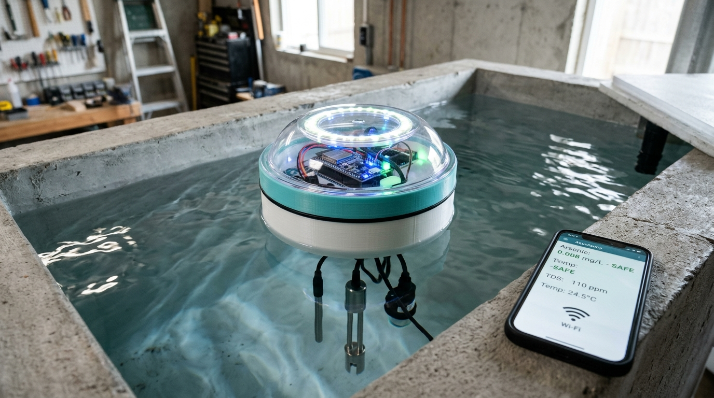

# AquaSentry Home: Personal In-Tank Water Quality & Arsenic Sentry
## Dedicated Household Storage Tank Surveillance Node



---

### 1. Concept: How It Works for One Person / Household

Unlike the autonomous lake catamaran which roams open waters, **AquaSentry Home** is engineered specifically for **one person or single family**. 

- **Placement**: Installed directly inside your domestic overhead water storage tank (e.g. Sintex 500L / 1000L / 2000L black/blue tank) or underground groundwater sump. It can either **float on a 3D-printed buoyant collar** or **clamp to the inspection rim**.
- **Private Reporting**: The unit connects directly to your home Wi-Fi (2.4 GHz). It reports real-time water data straight to your personal smartphone, laptop, or home dashboard without needing any paid subscription.
- **Local Alerts**: 
  - An onboard 360° RGB LED ring glows through a clear dome on the tank lid:
    - 🟢 **Solid Green**: Water Safe (Arsenic $< 10\ \mu\text{g/L}$, TDS normal, pH 6.8–7.8).
    - 🟡 **Amber**: Caution (Exceeds WHO guideline, filter maintenance advised).
    - 🔴 **Pulsing Red + Audio Beep**: Hazardous contamination ($> 50\ \mu\text{g/L}$ or acute turbidity spike).
  - Pushes instant WhatsApp / Telegram / local Web notifications to your phone.

---

### 2. Motherboard Options with Wi-Fi

| Motherboard Option | Price Range (INR) | Wi-Fi / Specs | Verdict for Personal Tank Use |
| :--- | :--- | :--- | :--- |
| **ESP32 DevKit V1 (30 / 38 Pin)** *(Recommended)* | **₹350 – ₹550** | 802.11 b/g/n (2.4 GHz) + BLE, Dual-Core 240MHz, 520KB SRAM | **Best Choice.** Ubiquitous in India (Robu.in, ElectronicsComp, Amazon). Enough horsepower to run on-edge neural model, Wi-Fi web server, and all analog pins. |
| **Raspberry Pi Pico W** | **₹550 – ₹750** | 802.11n Wi-Fi, Dual-Core ARM Cortex-M0+ 133MHz | Great for MicroPython lovers, but has only 3 ADC channels and slightly higher analog noise. |
| **ESP32-S3 DevKit** | **₹650 – ₹950** | Dual-Core LX7 with Vector AI acceleration, Wi-Fi 4 + BLE 5 | High-end overkill; great if you want advanced on-chip machine learning or camera integration. |
| **NodeMCU ESP8266** | **₹220 – ₹320** | 802.11 b/g/n, Single-Core 80MHz | Too limited: only 1 single analog pin (A0); requires external multiplexer to read multiple probes. |

---

### 3. Complete Bill of Materials (BOM) in Indian Rupees (₹ / INR)

All parts are standard, widely stocked robotics/electronics components available across India from platforms like **Robu.in**, **ElectronicsComp.com**, **Quartzcomponents.com**, or **Amazon.in**.

#### A. Microcontroller & Wi-Fi Core
| Component | Function on Device | Price Range (INR) |
| :--- | :--- | :--- |
| **ESP32 DevKit V1 (30-Pin Micro-USB / Type-C)** | Motherboard brain: reads all sensors, controls the sampling pump, connects to home Wi-Fi, and hosts local user dashboard. | **₹350 – ₹550** |
| **ADS1115 16-Bit 4-Channel I2C ADC Module** | Precision analog-to-digital converter ($7.8\ \mu\text{V}$ resolution) to read micro-volt/nano-amp electrochemical stripping peaks. | **₹220 – ₹380** |
| **LM358 Dual Op-Amp (or MCP6002 Rail-to-Rail)** + basic resistors & capacitors on mini perfboard | Miniature potentiostat circuit: provides voltage sweep (-0.8V to +0.4V) and Transimpedance Amplifier (TIA) for current measurement. | **₹80 – ₹150** |

#### B. Electrochemical Arsenic Sensing Unit
| Component | Function on Device | Price Range (INR) |
| :--- | :--- | :--- |
| **Screen-Printed 3-Electrode Strip** *(MAS-G1 / DropSens Gold Working Electrode)* | **[The One Specialized Part]** Stripping voltammetry strip (Gold WE, Ag/AgCl RE, Carbon CE) to detect dissolved Arsenic ($As^{3+}$). | **₹350 – ₹650** *(per strip / cartridge)* |
| **12V / 5V DC Micro Peristaltic Dosing Pump** | Draws a 10–15 mL fresh water sample into an enclosed 3D-printed cell once a day, then purges it. **Keeps the sensor strip dry between tests, extending strip life from days to months!** | **₹450 – ₹850** |
| **Single-Channel 5V Relay Module or MOSFET Driver (IRF520)** | Allows the 3.3V ESP32 to switch the 12V peristaltic pump on and off. | **₹40 – ₹90** |
| **Food-Grade Silicone Tubing (2mm ID / 4mm OD, 2 meters)** | Suction hose dipping 30 cm into the tank water to pull fresh water without surface dust. | **₹80 – ₹150** |

#### C. Continuous Auxiliary Water Quality Probes
| Component | Function on Device | Price Range (INR) |
| :--- | :--- | :--- |
| **DS18B20 Waterproof Stainless Probe** | Reads water temperature. Temperature dictates arsenic stripping kinetic rates and feeds calibration. | **₹120 – ₹220** |
| **Analog TDS / Electrical Conductivity Sensor Module** | Continuously measures Total Dissolved Solids / salinity. Instantly detects if municipal water is mixed with tanker/borewell water. | **₹280 – ₹450** |
| **Analog Turbidity Sensor Module (Optical IR)** | Detects suspended sediment/rust inside the tank; notifies user when tank needs manual cleaning. | **₹450 – ₹750** |
| **Analog pH Sensor Kit (E-201-C Glass Probe + 4502C Board)** *(Optional)* | Measures acidity/alkalinity ($pH\ 5.5 - 9.5$). Arsenic toxicity/speciation is pH-dependent. | **₹950 – ₹1,500** |

#### D. Power, Alerts & Enclosure
| Component | Function on Device | Price Range (INR) |
| :--- | :--- | :--- |
| **12V 2A Regulated DC Power Adapter + DC Jack Extension** | Powers the unit from the nearest household plug point (e.g. geyser socket or rooftop water pump switchboard). | **₹250 – ₹450** |
| **LM2596 DC-DC Step-Down Buck Converter** | Steps 12V down to clean 5.0V to power ESP32, ADC, and sensors. | **₹60 – ₹120** |
| **WS2812B NeoPixel RGB LED Ring (8 or 12 LEDs)** | 360-degree color ring on the tank top lid giving instant visual potability status (Green / Amber / Red). | **₹120 – ₹220** |
| **Active 5V Piezo Buzzer** | High-pitch local audible alarm if acute arsenic ($> 50\ \mu\text{g/L}$) or dangerous contamination occurs. | **₹20 – ₹40** |
| **3D-Printed PETG Enclosure & Flange (approx. 250g)** | Watertight cylindrical shell, internal sample well, and tank mounting bracket. | **₹250 – ₹450** *(material cost)* |
| **O-Ring Gasket / Silicone Sealant + Stainless Screws** | Hermetically seals electronics against high tank humidity and condensation. | **₹80 – ₹150** |

---

### 4. Total Cost Summary in Rupees (INR)

* **Minimalist Budget DIY Build** *(ESP32 + Arsenic Potentiostat + TDS + Temp + Pump + 3D Shell + Power Adapter)*:  
  **₹2,350 – ₹3,400**
* **Complete Comprehensive Sentry** *(ESP32 + Arsenic ASV + pH + Turbidity + TDS + Temp + Pump + LED Ring + Buzzer + 3D Shell)*:  
  **₹4,200 – ₹6,100**

*(Compare this to commercial industrial water analyzers which retail for ₹45,000 to ₹1,50,000+!)*

---

### 5. System Wiring & Communication Architecture

```mermaid
flowchart TD
    subgraph Power["Household Power Input"]
        WallPlug["12V 2A DC Adapter (from Pump/Geyser Socket)"] --> Buck["LM2596 Buck Converter (Outputs 5V 2A)"]
    end

    subgraph Motherboard["Avionics & Wi-Fi Processing"]
        ESP32["ESP32 DevKit V1 (Wi-Fi 2.4 GHz)"]
        Buck --> ESP32
        Buck --> Relay["5V Single-Channel Relay / MOSFET"]
        ESP32 -- GPIO Trig --> Relay
        Relay --> Pump["12V Micro Peristaltic Pump"]
    end

    subgraph WaterTank["Inside Personal Water Tank"]
        TDS["Analog TDS Probe (Continuous)"] --> ESP32
        Temp["DS18B20 Temp Probe (1-Wire)"] --> ESP32
        Turb["Turbidity Sensor (Continuous)"] --> ESP32
        PH["Analog pH Probe (Continuous)"] --> ESP32

        subgraph ASVChamber["3D-Printed Sealed Sample Chamber (15 mL)"]
            Pump -- Draws 15mL / Day --> ASVChamber
            Strip["MAS-G1 / DropSens 3-Electrode Strip"]
            Potentiostat["LM358 Dual Op-Amp Potentiostat Circuit"]
            ADS1115["ADS1115 16-Bit I2C ADC Module"]
            ESP32 -- DAC Voltage Ramp --> Potentiostat
            Strip <--> Potentiostat
            Potentiostat --> ADS1115
            ADS1115 -- I2C --> ESP32
        end
    end

    subgraph UserInterface["Direct Personal Reporting"]
        ESP32 -- Wi-Fi Local HTTP/MQTT --> Router["Home Wi-Fi Router"]
        Router --> Phone["User's Smartphone / Web Dashboard"]
        ESP32 --> LEDRing["WS2812B NeoPixel RGB Ring (Green/Amber/Red)"]
        ESP32 --> Buzzer["Piezo Alarm Buzzer"]
    end
```

---

### 6. Daily Operation Cycle (How It Reports to You)

1. **Continuous Baseline Monitoring (24/7)**:
   * The TDS, pH, and Temperature probes stay submerged in the tank. Every 15 minutes, the ESP32 takes a reading.
   * If tank TDS spikes (e.g. municipal water switched to unpurified groundwater), you receive an immediate notification on your phone.
2. **Automated Morning Arsenic Stripping Cycle (e.g., 6:00 AM)**:
   * Before the household begins morning cooking/bathing, the ESP32 activates the peristaltic pump for 6 seconds.
   * 15 mL of water is drawn into the internal sealed chamber.
   * Anodic Stripping Voltammetry (ASV) is performed: deposition at $-0.8\text{ V}$ followed by an anodic stripping ramp to $+0.4\text{ V}$.
   * The [`AquaNet-V1`](file:///Users/nehalmathur/Desktop/Projects/Arsenic%20sensor(HKU)/AquaSentry_Complete_System/app/neural_classifier.py) neural model computes risk:
     * **If Safe**: NeoPixel glows serene Green. App updates: *"Arsenic: 0.007 mg/L — Water is safe for domestic use."*
     * **If Unsafe**: NeoPixel turns flashing Red, piezo buzzer sounds, and your phone receives an urgent alert: *"High Arsenic Detected (0.058 mg/L)! Do not drink or cook before filtration."*
   * The pump reverses, purging the 15 mL sample back out, keeping the sensor strip dry until the next test.
3. **Local Private Dashboard**:
   * Type `http://aquasentry.local` (or the ESP32's local IP address like `192.168.1.145`) on any phone or laptop connected to your home Wi-Fi to view historical trend charts, battery/power health, and filter lifespan.

---

### 7. 3D Printing Recommendations for the Personal Tank Shell

* **Filament**: **PETG** (Food-grade certified, zero BPA, handles temperatures up to $75^\circ\text{C}$ on hot summer rooftops).
* **Layer Height**: **0.20 mm** with **4 perimeters** for 100% watertight sealing.
* **Mounting Design**:
  * Print a curved hanging bracket that hooks over the lip of standard 400mm / 500mm inspection manholes of Sintex or Supreme water tanks.
  * The electronics dome remains above the waterline, while the modular probes suspend 30–50 cm into the center of the water column.
