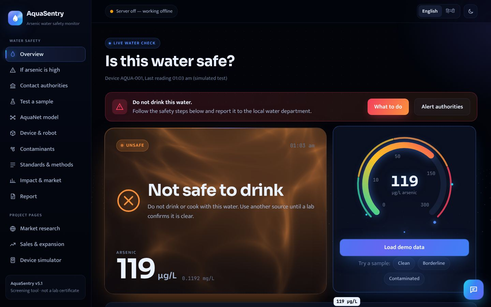
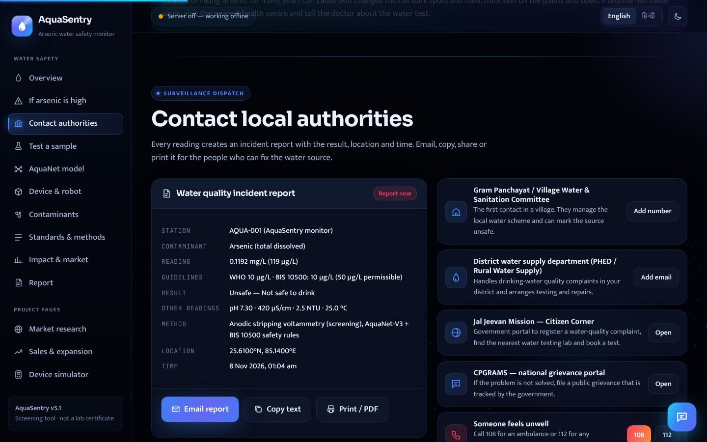
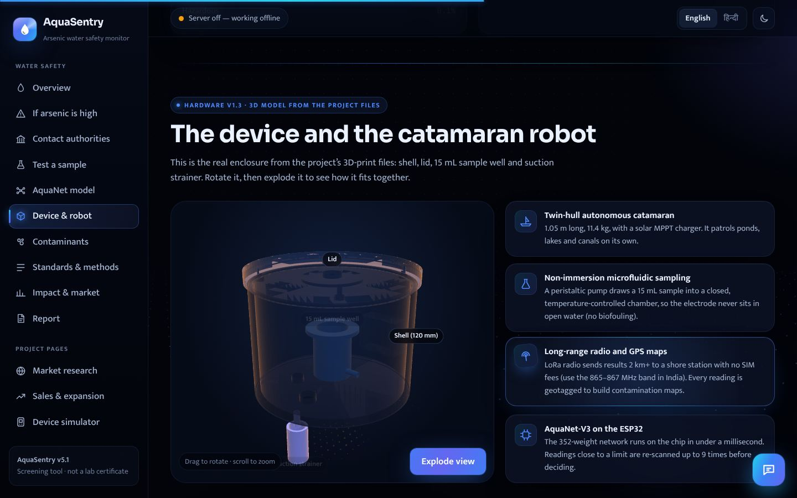

# AquaSentry — low-cost arsenic and water-safety monitor

[](https://github.com/yashveersinghgarewal-hub/AquaSentry_Final/actions/workflows/ci.yml)

AquaSentry measures arsenic in drinking water with **anodic stripping voltammetry** on an **ESP32**, checks pH, conductivity, turbidity and temperature, and decides whether the water is **Safe, Caution, Unsafe or Hazardous** (WHO and Indian IS 10500 limits: arsenic 10 µg/L, no relaxation since the 2015 amendment). A small neural network, **AquaNet-V3**, runs both on the ESP32 and on the server; fixed safety rules run after it and can only make a verdict stricter.

| Part | Folder | What it does |
| --- | --- | --- |
| Web platform + dashboard | [`AquaSentry_Platform/`](AquaSentry_Platform/) | FastAPI server, SQLite database, lab confirmations and calibration, sensor map and QR pages, alerts (push / WhatsApp / SMS), PDF screening reports, and the dashboard (English, Hindi, Bengali, Assamese, Punjabi; works offline) |
| ESP32 firmware | [`Firmware/`](Firmware/) | Runs the voltammetry scan (3 scans, up to 9 near a limit), pH / conductivity / turbidity / temperature, AquaNet-V3 on the chip, offline buffer, Wi-Fi upload, updates with rollback |
| Neural network | [`Neural_Network/`](Neural_Network/) | AquaNet-V1 (original), V2 and V3 (in use), training code in `v3_training/` |
| Hardware | [`models_3d/`](models_3d/), [`Docs/hardware/`](Docs/hardware/) | Printable enclosure, assembly manual, tank and catamaran versions |
| Data and analysis | [`Data/`](Data/), [`Analysis/`](Analysis/) | Example scans and calibration, field-data template (`Data/field/`), scan generator, paired-validation and model-evaluation scripts |
| Desktop app | `desktop_app.py` | Opens the dashboard in its own window |
| Docs | [`Docs/`](Docs/) | **[Documentation index](Docs/README.md)**: run guide, ISEF roadmap, code guide, neural-network reports, video |

## For competitions (ISEF / IRIS)

**[`Docs/ISEF_ROADMAP.md`](Docs/ISEF_ROADMAP.md)** lists 267 prioritised changes for Regeneron ISEF-level judging, grouped by the official criteria, starting with the rules that can disqualify a project (generative-AI use, the 12-month window, hazardous-chemical forms). The two biggest gaps it targets: the results so far come from **simulated data**, and the arsenic detection limit (**20 µg/L**) is above the **10 µg/L** legal limit.

**[`Docs/ISEF_ROADMAP_STATUS.md`](Docs/ISEF_ROADMAP_STATUS.md)** is the status of all 267 items — **57 done in software, 67 with the tooling ready for real data, 29 partly done, 114 team / laboratory / field items** each with its worksheet in [`Docs/TEAM_WORKBOOK.md`](Docs/TEAM_WORKBOOK.md) (steps, template in `Docs/templates/`, script in `Analysis/`, where to record). What is left, as one checklist with the must-do items first: **[`Docs/REMAINING_WORK.md`](Docs/REMAINING_WORK.md)**. No item is unaddressed; "done" means nothing is left to measure for that item.

## What changed in v5.10

Every roadmap item not closed by v5.9 is addressed, and the register is stricter about what "done" means.

- **[`Docs/REMAINING_WORK.md`](Docs/REMAINING_WORK.md)**: the 210 open items as one checklist, P0 first, grouped into laboratory, field, run-the-ready-tools, finish-what-software-started and team work.
- **Honest status** (Nalin Aggarwal): 29 items whose software exists but has never seen real samples or hardware are "tooling ready", not "done".
- **The two open software items**: a 1-D CNN on raw voltammograms in the research pipeline (item 157, fed by `GET /api/scans/export`) and a reference-electrode settle test in firmware 5.10.0 (item 174, `REF_UNSTABLE`).
- **Analysis scripts for the laboratory and field items**: `linearity.py`, `doe_factorial.py`, `electrode_study.py`, `power_budget.py`, `deployment_report.py`, `decision_matrix.py`, `scale_estimate.py`; `make_poster_figures.py` runs them all.
- **Worksheets and templates**: `Docs/TEAM_WORKBOOK.md` (Do / Use / Record for every open item) and 29 templates in `Docs/templates/`.
- **Clearer screens** (Nalin Aggarwal): practice controls kept apart from real results, the lab comparison and trend warnings in plain words, a tidier device list, phone layout fixes, one version label everywhere, OSM credit link.
- **Current dependencies**: FastAPI, Uvicorn, httpx, pypdf and the GitHub Actions brought up to date; every test passes on the newest versions.

## What changed in v5.9

The ISEF roadmap, item by item. No new product features (item 257); only what the roadmap asks for.

- **Status register for all 267 items** (`Docs/planning/isef_roadmap_status.csv` → `Docs/ISEF_ROADMAP_STATUS.md`, regenerated by `Analysis/roadmap_status.py`, checked by a test).
- **Sample metadata** (items 111–112): how the bottle was taken — source kind, depth, purge time, bottle ID, preservation, collector initials, collection time, custody note, split-for-lab — stored with every reading or scan and flattened into the paired export.
- **QC run types** (items 89, 91, 98): `field_blank`, `spike_recovery` (with the unspiked baseline, 80–120 % recovery) and sensor checks `ph_buffer`, `conductivity_standard`, `turbidity_standard`, `temperature_reference`; `/api/qc/status` says which auxiliary sensors are verified.
- **Judging mode** (items 195, 258, 262): the podium icon or `?mode=judging` hides market, sales, impact and the assistant; three science screens remain.
- **Analysis scripts** (items 76, 95–96, 99, 132, 134, 139, 141, 148–155): `aquanet_v3_field_eval.py` (the deployed network vs laboratory classes, baselines, ablation, reliability, 352 parameters counted), `interference.py` (recovery vs interferent with CIs), `run_order.py` (blinded randomised run sheets + sealed key), `control_chart.py` (Shewhart with Western Electric rules), `peak_check.py` (algorithm vs hand-measured peaks), `project_figures.py` (Gantt, design history, cost model from a BOM, cost-vs-LOD landscape, printable QR), `make_poster_figures.py` (every figure from the raw files in one command); `paired_validation.py` adds the 50 µg/L cutoff, per-lot / per-site tables, replicate CV % and a sample-size table.
- **Documents** (items 2, 11, 20, 53–54, 102, 176, 181, 199–200): AI-use statement template, credits and licences, decision log, FMEA, requirements traceability, SOP, pinout, hardware changelog, privacy and performance, demo script.
- **Firmware 5.9.0**: time to first result on serial and `/status.json` (item 186). Certificates name firmware, model, analysis and calibration versions (items 161, 191). Export coordinates rounded to ~100 m unless asked otherwise (item 30, 199). Colour-blind-safe figure palette (item 146).

## What changed in v5.8

Built from the 8 Nov 2026 **Research and Engineering Review** (60 items) and the ISEF list. [`Docs/ROADMAP_COVERAGE.md`](Docs/ROADMAP_COVERAGE.md) maps each item to code and tests, or says it needs the laboratory; [`Docs/CLAIMS_REGISTER.md`](Docs/CLAIMS_REGISTER.md) lists every claim with its evidence or marks it a target.

- **One outcome per test.** Beside the tier, every result says **invalid**, **not detected**, **retest** or **screen positive**. The borderline band is the reading's own uncertainty (± U, k = 2, measured from the scan), so a 17 ± 6 µg/L reading is "retest and confirm in a lab", not "safe".
- **Scans are evidence.** The raw current-vs-potential points of each test are stored with a SHA-256 checksum, analysis version, calibration ID and firmware; any reading's stored scan can be viewed, and reprocessed with a later calibration without touching the original value. Browser and server run the same checked pipeline.
- **Bad scans fail visibly.** Jumbled, short, non-finite, saturated or shoulder-less traces are rejected with a reason and no number, whatever the source. The factory calibration is labelled what it is: a synthetic example.
- **Real data has a mode.** Live / recorded replay / simulation / demo are separate; **Replay a recorded scan** imports an instrument file and the result is real data, never a live alert.
- **Lab pairing and export.** Censored lab results ("< reporting limit") are kept as such; the paired node-vs-lab table exports in one call. `Analysis/paired_validation.py` (Deming, Bland–Altman, Wilson CIs, ROC, near-cutoff band) and `Analysis/aquanet_v2_pipeline.py` (site-grouped comparison of the calibration line against ridge / PLS / a residual MLP, conformal intervals, referral-vs-miss curve) turn that table into the judge figures. Both run today only on **labelled synthetic** demo data.
- **ESP32 firmware 5.8.0** uploads the native trace of each reading and runs a boot self-test (ADC/DAC present, storage, calibration age, inference time). The **bridge** accepts trace blocks and recorded CSV files, with a durable outbox and stable scan IDs.
- Hardening: finite, bounded inference inputs (422, not 500), 2 MB request cap, calibration LOD floored at the method LOD.

## What changed in v5.7

Two parts. **Part 1** (PR #3): the ISEF / IRIS roadmap above, a tidier repository (`Docs/` index, launchers in `scripts/`, older documents in `Docs/archive/`) and a clearly labelled demo field programme (`AquaSentry_Platform/scripts/seed_field_demo.py`). **Part 2**: a safety release from a harm review of v5.6. Nothing in it needs new hardware; it makes the software refuse to look reassuring when it cannot know.

- **A dead or drifting electrode can no longer look like clean water.** Every scan is checked on the ESP32 and on the server: a flat signal (disconnected, dry or worn electrode), too much noise to see the 20 µg/L detection limit, or a peak outside the search window rejects the scan. A reading needs at least 2 good scans that agree, or it is reported as **Test failed**, never as a low value.
- **Check standards.** A low reading from a device is only trusted if the sensor passed a check standard (a known arsenic solution, 80–120 % recovery) in the last 7 days and has a calibration made on its electrode. Run one from the device's new `/qc` page or `POST /api/qc/runs`. Detected arsenic is always kept, with a warning, even from an unverified sensor.
- **Nothing is assumed for sensors that are not fitted.** pH, conductivity, turbidity and temperature that were not measured are "Not measured" in the verdict, the message, the PDF and the dashboard (the verdict used to assume 7.2 / 400 / 2 / 24). Python, JavaScript and the ESP32's C engine agree on this.
- **Honest headlines.** Below 20 µg/L the dashboard says **"Not detected: not confirmed safe"** and shows "< 20" instead of a noise value like 9.6; the public QR page and the map do the same, and "not detected" is no longer painted safe-green.
- **Practice data stays practice.** Dashboard tests no longer copy invented pH, battery or GPS values (25.61°N, 85.14°E); they are stored under `SIM-DASHBOARD`, cannot be sent to authorities, and their PDF is stamped **"SIMULATED / DEMO DATA: NOT A REAL WATER TEST"**. Simulated alerts never reach the alert webhook.
- **Old data is flagged.** A device reading older than 2 hours is marked "may be offline: do not rely on it"; a reading whose device did not report its sample time says so.
- **Writes locked down.** Without `AQUASENTRY_API_KEY`, only this computer can add data (before: the whole network). Another website open in your browser can no longer post readings through `localhost`, and CORS is limited to the dashboard (was `*`).
- **Claims corrected.** LoRa and GPS are described as planned (the firmware uses Wi-Fi); accuracy figures say "simulated"; the market page no longer states unverified facts about AccuSense; the incident report says "As(III) only" unless total arsenic was measured.
- **ESP32 firmware 5.7.0:** scan QC, wider peak search (±100 mV) with a "shifted peak" warning, `qc_status` and `qc_scan_flags` in each upload, the `/qc` page, and the on-chip model treats missing sensors as not measured. Buffered 5.6 readings stay readable (the new fields use padding bytes) and are reported as unchecked.

## What changed in v5.6

- **Is the reading trustworthy?** Each reading now says what the sensor can see. Without the acid electrolyte step the gold electrode only detects **As(III)**, so the dashboard warns that the number can be too low. An optional dosing pump measures total arsenic. Copper interference and factory-only calibration are flagged too.
- **Lab confirmations:** enter ICP-MS / HG-AAS / field-kit results; they are matched to the sensor reading and give the sensor's real record (missed unsafe samples, sensitivity with a 95% interval, bias, As(III) share).
- **Calibration** by external standards or **standard addition** in the real water, pushed to each node.
- **Map** of sensor nodes, **QR sticker** for each handpump linking to a public page with the latest verdict, and a **Jal Jeevan Mission style CSV**.
- **Alerts to people:** phone/browser push, WhatsApp (Cloud API) and SMS (MSG91 with DLT, or Twilio), only for real sensor readings, without repeat spam.
- **Bengali, Assamese and Punjabi** for the safety-critical text (arsenic-belt states), alongside English and Hindi.
- **ESP32 firmware 5.6.0:** pH, conductivity, turbidity and temperature drivers, the copper scan, calibration from the server, server-pulled updates with rollback.
- **Engineering:** database migrations (Alembic), routers, JSON logs with request IDs, optional read protection, a strict style CSP on the dashboard, lazy-loaded 3D model, browser tests + WCAG audit + Lighthouse in CI.

Older release notes (v2 → v5.5): **[`CHANGELOG.md`](CHANGELOG.md)**. Every change since v5.1 with its reason and source: **[`Docs/IMPROVEMENT_LOG.md`](Docs/IMPROVEMENT_LOG.md)**.

## Screenshots

| Live dashboard | Contact local authorities |
| --- | --- |
|  |  |
| **3D device model** | **Market research** |
|  |  |

## Quick start

**Windows:** install Python 3.10+ (tick *Add python.exe to PATH*), then double-click **`Start AquaSentry Desktop.bat`**.
**macOS / Linux:** `./run_desktop.sh` (or `./scripts/setup_and_run.sh` for the browser version).
**Docker:** `docker compose up -d`, then open http://localhost:8000.

The first run creates a `.venv` folder and installs packages (needs internet). Every other way to run it (ESP32 on your Wi-Fi, demo data for presentations, VS Code, troubleshooting): **[`Docs/HOW_TO_RUN.md`](Docs/HOW_TO_RUN.md)**.

**Tests:** `python main.py --test` (neural toolkit + platform; 3xx server tests, the exact count is printed). Browser tests: `cd AquaSentry_Platform && python -m pytest tests_e2e`. Lint: `ruff check .` GitHub Actions also builds the ESP32 firmware for 8 board/option combinations and runs an accessibility audit and Lighthouse.

**AI assistant (optional):** copy `AquaSentry_Platform/.env.example` to `.env` and add your own Gemini key. `.env` is in `.gitignore`; never commit API keys.

## AquaNet-V3 in one paragraph

V3 is a 5-16-12-4 network (352 weights, 1.4 KB on the ESP32). It was trained on simulated readings **with realistic sensor noise**, so it learns to be careful when a measurement sits close to a limit. Results and method: **[`Docs/neural/AQUANET_V3_REPORT.md`](Docs/neural/AQUANET_V3_REPORT.md)**. All numbers come from simulated data; the model still needs to be checked against real lab-tested water samples before anyone relies on it.

## Folder layout

```text
AquaSentry_Final/
├── README.md, CHANGELOG.md, SECURITY.md
├── main.py                       command line: --serve, --test, --csv, --neural, --version
├── desktop_app.py                desktop window (pywebview); --browser, --lan
├── Start AquaSentry Desktop.bat  Windows double-click: desktop app (first run installs .venv)
├── Start AquaSentry for ESP32.bat  Windows: server reachable from the ESP32 on your Wi-Fi
├── run_desktop.sh                macOS / Linux desktop app
├── requirements.txt, requirements-desktop.txt, ruff.toml
├── Dockerfile, docker-compose.yml, docker-entrypoint.sh
├── scripts/                      setup_and_run (browser version), run_all_tests, build_desktop_exe
│
├── AquaSentry_Platform/          FastAPI server, dashboard, tests (see its README)
│   ├── app/                      API, rules, AquaNet-V3, signal processing, alerts, migrations
│   ├── frontend/                 dashboard and other pages, translations, vendored libraries
│   ├── tests/, tests_e2e/        unit/API tests; browser + accessibility tests
│   ├── scripts/                  training, model install, demo data, stress test, PDF export
│   ├── data/, bridge/            example data; serial bridge
│   └── aquasentry.db             starter database (test and demo readings only)
├── Firmware/                     ESP32 sketch (esp32_firmware/), host build check, PlatformIO config
├── Neural_Network/               AquaNet V1–V3 toolkit, weights, v2/v3 training, parity tests
├── models_3d/                    enclosure, lid, tank bracket, sample well, strainer (STL / 3MF)
├── Data/                         example scans, calibration
├── Analysis/                     scan generator, MAS-G1 analysis
├── AI_Agent/                     separate research assistant (command line, not part of the platform)
└── Docs/                         index, run guide, ISEF roadmap, code guide, improvement log,
                                  neural/, hardware/, media/ (video, screenshots), archive/ (older documents)
```

Some files exist in two or three places on purpose, so that each part runs on its own: the AquaNet C engine (`Neural_Network/` and `Firmware/esp32_firmware/`), the AquaNet-V3 code and weights (`Neural_Network/` and `AquaSentry_Platform/app/`), the example data (`Data/`, `AquaSentry_Platform/data/`, `Neural_Network/`) and the two prototype renders (`Docs/hardware/` and the dashboard). A test (`AquaSentry_Platform/tests/test_repo_layout.py`) fails if any copy drifts, and checks that every relative link in the documentation still works.

## The neural network in C (ESP32)

The ESP32 runs **AquaNet-V3** from `Firmware/esp32_firmware/aquanet_v3.c`. It is generated from the trained weights, uses float32 only (the ESP32 has a hardware FPU), keeps all weights in flash, never calls `malloc`, and only needs `<math.h>`. It also compiles for STM32, Arduino-class ARM boards and any C99 compiler.

```bash
cd Firmware/esp32_firmware
clang -std=c99 -Wall -Wextra -Werror -c aquanet_v3.c aquanet_v1.c
```

**C API:**
```c
#include "aquanet_v3.h"

aquanet_result_t r = aquanet_v3_predict(0.0075f /* arsenic mg/L */, 7.2f /* pH */,
                                        400.0f /* EC uS/cm */, 2.0f /* NTU */, 24.0f /* C */);
// r.predicted_class: 0 = Safe, 1 = Caution, 2 = Unsafe, 3 = Hazardous (after safety rules)
// r.raw_model_class: the network's own vote;  r.confidence_pct, r.probabilities[4], r.entropy
```

To install a newly trained model everywhere at once (server, dashboard and ESP32 code):
`cd AquaSentry_Platform && python scripts/install_aquanet_v3.py <model.json>`

---

## Team

ISEF item 267 — complete when the team is final (names, roles, school, research year start date).

| Name | Role | Contribution (from the repository history) |
|---|---|---|
| Yashveer Singh Garewal | Project lead | Repository owner; direction, reviews, releases |
| Nalin Aggarwal | Contributor | v5.2–v5.7 branches: standards fix, firmware hardening, fleet API, alerts, lab results, calibration, ISEF roadmap |
| *(mentor)* | Qualified Scientist / Designated Supervisor | *to add* |

AI assistance (Claude, Anthropic) was used for code, tests and documentation drafts; see `Docs/AI_USE_STATEMENT_TEMPLATE.md` and `Docs/CREDITS.md`.

## Limits used

* **WHO Guideline Limit**: $0.010\text{ mg/L}$ ($10\ \mu\text{g/L}$).
* **IS 10500 Limit (acceptable = permissible, no relaxation since Amendment No. 1, 2015)**: $0.010\text{ mg/L}$ ($10\ \mu\text{g/L}$). The older 0.050 mg/L "permissible" value is withdrawn and is not used anywhere.
* **Acute Hazard Limit**: $> 0.150\text{ mg/L}$ ($150\ \mu\text{g/L}$).
* **Method Limit of Detection (LOD)**: $0.020\text{ mg/L}$ ($20\ \mu\text{g/L}$).
