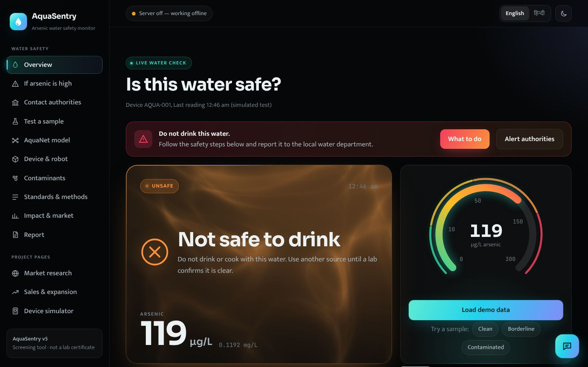
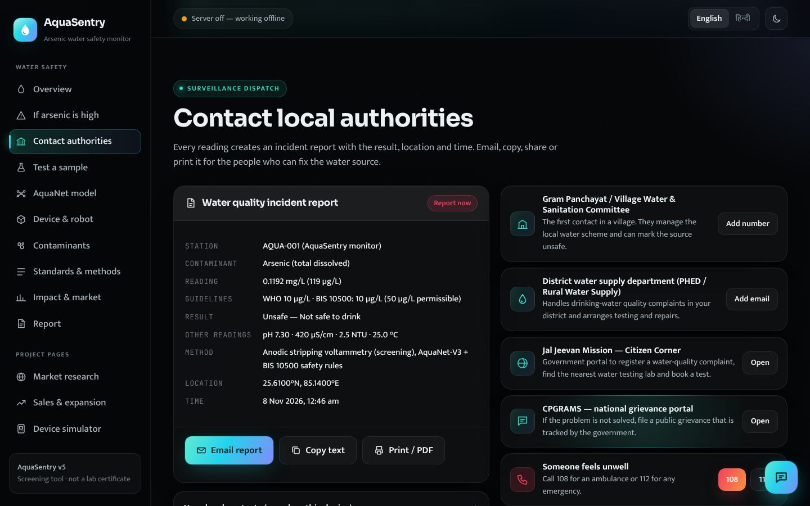

# AquaSentry — low-cost arsenic and water-safety monitor

AquaSentry measures arsenic in drinking water with **anodic stripping voltammetry** on an **ESP32**, checks pH, conductivity, turbidity and temperature, and decides whether the water is **Safe, Caution, Unsafe or Hazardous** (WHO and Indian IS 10500 limits: arsenic 10 µg/L, no relaxation since the 2015 amendment). A small neural network, **AquaNet-V3**, runs both on the ESP32 and on the server; fixed safety rules run after it and can only make a verdict stricter.

| Part | Folder | What it does |
| --- | --- | --- |
| Web platform + dashboard | `AquaSentry_Platform/` | FastAPI server, SQLite database, PDF screening reports, and the v5 UI: live dashboard (what to do if arsenic is high, contact local authorities, 3D device model), market research, sales & ROI calculator and a device simulator — English/Hindi, carbon-black or light, works offline |
| ESP32 firmware | `Firmware/esp32_firmware/` | Runs the voltammetry scan (3 scans, up to 9 when a reading is close to a limit), runs AquaNet-V3 on the chip, sends readings to the server over Wi-Fi |
| Neural network | `Neural_Network/` | AquaNet-V1 (original), V2 and V3 (current) + training code in `v3_training/` |
| Desktop app | `desktop_app.py` | Opens the dashboard in its own window |
| Docs | `Docs/`, `AQUASENTRY_CODE_GUIDE.md` | Code guide, neural-network guide, explainer video, hardware manuals |

## What changed in v5.2 (audit release)

- **Arsenic limit corrected.** India's IS 10500 arsenic limit has been 10 µg/L with *no relaxation* since Amendment No. 1 (2015); the old 50 µg/L "permissible" value was withdrawn. Every engine (server, browser, ESP32 C, Neural_Network copy) now treats any arsenic the sensor detects (≥ 20 µg/L LOD) as at least **Unsafe**, 10–20 µg/L as **Caution** (unconfirmed, lab test), and > 150 µg/L as **Hazardous**. Alerts fire on every Unsafe/Hazardous verdict.
- **No more "Safe to drink" below the detection limit.** The sensor cannot see 10 µg/L, so a clean reading now says **"No arsenic detected"** and asks for one lab test.
- **Write protection** with `AQUASENTRY_API_KEY` (the ESP32 sends it as `X-API-Key`); admin endpoints are never open to the network.
- Fixes: real zeros (0 NTU, 0 °C) were replaced by defaults; CSV import read columns like `class` or `recorded_at` as arsenic/conductivity; timestamps lacked a time zone; the firmware retried a rejected reading forever and stamped offline readings with upload time; OTA accepted the default password; health/PDF named the wrong model.
- **AquaNet-V3 retrained** on the corrected edges: its own vote now matches the rules 98.6% of the time (was 88.6%), and with the firmware's adaptive re-scan it misses 11% fewer dangerous samples in simulation. Same 352-parameter size; C ↔ Python parity 0 mismatches on 100,000 inputs.
- `scripts/reclassify_readings.py` re-applies the current rules to stored readings.
- 29 new regression and cross-engine parity tests (Python ↔ browser JS ↔ ESP32 C). Details: `CHANGELOG.md`.

## Screenshots

| Live dashboard | Contact local authorities |
| --- | --- |
|  |  |
| **3D device model** | **Market research** |
|  |  |

## Quick start

**Windows:** install Python 3.10+ (tick *Add python.exe to PATH*), then double-click **`Start AquaSentry Desktop.bat`**.
**macOS / Linux:** `./run_desktop.sh` (or `./setup_and_run.sh` for the browser version).

The first run creates a `.venv` folder and installs packages (needs internet). Full steps: **`WHATS_NEW_AND_HOW_TO_RUN.md`**.

Run all tests: `python main.py --test` (139 tests: 22 neural toolkit + 117 platform).

**With an ESP32:** start the server with **`Start AquaSentry for ESP32.bat`** (or `python main.py --serve --host 0.0.0.0 --port 8000`), then open `Firmware/esp32_firmware/esp32_firmware.ino` in the Arduino IDE, fill in Wi-Fi and server address, and upload. See `Firmware/README.md`.

**AI chatbot (optional):** copy `AquaSentry_Platform/.env.example` to `.env` and add your own Gemini key. `.env` is in `.gitignore` — never commit API keys.

## AquaNet-V3 in one paragraph

V3 is a 5-16-12-4 network (352 weights, 1.4 KB on the ESP32). It was trained on simulated readings **with realistic sensor noise**, so it learns to be careful when a measurement sits close to a limit. Results and method: **`Docs/AQUANET_V3_REPORT.md`**. All numbers come from simulated data; the model still needs to be checked against real lab-tested water samples before anyone relies on it.

---

## 1. Package Directory Layout

When unzipped on any computer, this package contains everything organized into clear, dedicated directories:

```text
AquaSentry_Universal/
├── setup_and_run.sh            # 1-Click launcher for macOS & Linux (auto venv + pip + server)
├── setup_and_run.bat           # 1-Click launcher for Windows (auto venv + pip + server)
├── run_all_tests.sh            # 1-Click test runner for macOS & Linux (139 tests)
├── run_all_tests.bat           # 1-Click test runner for Windows
├── main.py                     # Root universal command-line interface
├── requirements.txt            # Unified project dependencies
├── Dockerfile                  # Production container image
├── docker-compose.yml          # One-click Docker container deployment
├── README.md                   # This documentation guide
├── README.pdf                  # Formatted PDF publication
│
├── AquaSentry_Platform/        # Universal Fullstack Web Application
│   ├── app/                    # FastAPI backend (WebSocket, PDF certs, alerts, WAL DB)
│   ├── frontend/               # Interactive PWA dashboard with real-time UI & manifest
│   ├── bridge/                 # ADS1115 / ESP32 serial bridge and microcontroller bindings
│   ├── tests/                  # 117 automated API, safety, parity and scientific tests
│   ├── aquasentry.db           # Pre-configured SQLite database (WAL mode enabled)
│   ├── main.py                 # Platform-specific runner
│   └── run_tests.py            # Platform test runner with auto-venv detection
│
├── Neural_Network/             # Standalone AquaNet-V1 Neural Toolkit
│   ├── aquanet_classifier.py   # Python inference with Shannon entropy & INT8 Q10 mode
│   ├── aquanet_neural.js       # Pure-JavaScript browser inference engine
│   ├── aquanet_v1.h            # C99 header (Float32 + INT8 fixed-point forward passes)
│   ├── aquanet_v1.c            # C99 embedded engine (zero dynamic malloc, 148 bytes ROM)
│   ├── aquanet_v1_weights.json # Canonical 112 weight and bias floating-point matrices
│   ├── asv_extractor.py        # Multi-analyte deconvolution (As, Cd, Pb, Cu) & standard addition
│   ├── test_aquanet_parity.py  # 22-point neural topology, INT8 & strict parity test suite
│   ├── main.py                 # Standalone ML CLI
│   └── AQUANET_NEURAL_NETWORK_COMPREHENSIVE_GUIDE.pdf
│
├── Firmware/                   # ESP32 Production Microcontroller Firmware
│   ├── esp32_firmware/         # Arduino sketch folder (open the .ino from here)
│   │   ├── esp32_firmware.ino  # FreeRTOS dual-core tasks, adaptive 3-9 scan averaging, NVS buffer, Web OTA
│   │   ├── aquanet_v3.h/.c     # AquaNet-V3 edge AI (generated float32 C99, 1.4 KB)
│   │   └── aquanet_v1.h/.c     # V1 engine (shared result type + entropy)
│   └── README.md               # Pinout diagram, flashing & OTA guide
│
├── models_3d/                  # 3D Print CAD Models (Watertight STLs & 3MF)
│   ├── aquasentry_shell_base_full_120mm.stl # 120x85mm full-fit electronics shell base
│   ├── aquasentry_shell_lid_full_120mm.stl  # Lid with 2.5mm overhang drip skirt & gasket groove
│   ├── aquasentry_tank_bracket.stl          # Rigid dual-clamp overhead water tank bracket
│   ├── aquasentry_sample_well_15ml.stl      # 15 mL fluidic reaction & sensor well
│   ├── aquasentry_suction_strainer.stl      # 100-mesh weighted intake suction strainer
│   ├── aquasentry_complete_slicer_plate_120mm.stl # All components on single 3D printer bed
│   ├── aquasentry_complete_slicer_plate_120mm.3mf # Multi-part slicer project with print settings
│   └── aquasentry_shell_3d_rendering.png    # High-resolution photorealistic CAD rendering
│
├── AI_Agent/                   # AI Water Quality Research Agent
│   ├── main.py                 # Research agent: Claude (Anthropic) or GPT (OpenAI), chosen by which API key is set
│   ├── tools.py                # Specialized search & toxicology query tools
│   └── requirements.txt        # Agent dependencies
│
├── Data/                       # Raw Analytical Datasets & Calibration Curves
│   ├── example_data.csv        # Standard 81-point ASV square-wave scan
│   ├── arsenic_voltammetry_example.csv
│   ├── voltammetry2_arsenic_example.csv
│   └── example_calibration.json# Slope and intercept calibration constants
│
├── Analysis/                   # Signal Processing & Trace Generators
│   ├── generate_arsenic_data.py# Synthetic voltammogram generation with noise models
│   └── mas_g1_arsenic_analysis.py # Historical baseline subtractor
│
└── Docs/                       # Complete Engineering Specifications & Blueprints
    ├── AQUANET_NEURAL_NETWORK_COMPREHENSIVE_GUIDE.pdf
    ├── CATAMARAN_PROTOTYPE_SPEC.pdf
    ├── PERSONAL_TANK_SENTRY_BLUEPRINT.pdf
    ├── AQUASENTRY_HOME_ASSEMBLY_MANUAL.pdf
    ├── AQUANET_RETRAINING_REPORT.pdf
    └── AQUANET_V1_STRESS_TEST_REPORT.pdf
```

---

## 2. Quick Start on Any New Computer

### macOS & Linux (1-Click)
In your terminal, navigate to the unzipped folder and run:
```bash
chmod +x setup_and_run.sh
./setup_and_run.sh
```
*What this does automatically:*
1. Detects system `python3`.
2. Creates an isolated local virtual environment (`.venv`).
3. Installs all required packages from `requirements.txt`.
4. Launches the AquaSentry web platform on `http://localhost:8000` and opens your browser.

### Windows (1-Click)
Simply double-click:
```bat
setup_and_run.bat
```
or from the Command Prompt:
```cmd
setup_and_run.bat
```

---

## 3. Universal Command-Line Interface (`main.py`)

The root `main.py` provides immediate access to all subsystems:

```bash
# 1. Start the interactive web dashboard and REST API
python3 main.py --serve --port 8000

# 2. Run the complete automated test suite (all 139 tests)
python3 main.py --test

# 3. Analyze raw ASV voltammetric scan CSV and classify water safety
python3 main.py --csv Data/example_data.csv

# 4. Supply specific geochemical field parameters along with CSV
python3 main.py --csv Data/example_data.csv --ph 7.4 --ec 450 --turb 1.8 --temp 25.0

# 5. Run standalone AquaNet-V1 neural network evaluation scenarios
python3 main.py --neural

# 6. Display system architecture topology and versions
python3 main.py --version
```

---

## 4. Running the Complete Test Suite

You can run all 139 tests across the entire platform in a single command:
```bash
./run_all_tests.sh
```
*Test Coverage Breakdown:*
* **22 Standalone Neural Parity Tests** ([`Neural_Network/test_aquanet_parity.py`](Neural_Network/test_aquanet_parity.py)):
  * Exact 23-node, 112-synapse topology verification.
  * Out-of-bounds (OOB) physical sensor fail-safes.
  * Multi-parameter WHO/BIS 10500 potability downgrades (pH, Turbidity, Conductivity).
  * Conservative precedence overrides for arsenic limits.
  * Numerical stability (softmax sum = 1.0, float64 scaling).
* **117 Platform Integration Tests** ([`AquaSentry_Platform/run_tests.py`](AquaSentry_Platform/run_tests.py)):
  * REST API endpoints, health checks, reading ingestion, deduplication.
  * Signal processing (Savitzky-Golay filters, baseline tilt subtraction).
  * Chat policy prompt-injection filters & emergency toxicology gates.
  * Data export/import schema integrity.

---

## 5. Microcontroller (ESP32) Deployment

The ESP32 runs **AquaNet-V3** from `Firmware/esp32_firmware/aquanet_v3.c`. It is generated from the trained weights, uses float32 only (the ESP32 has a hardware FPU), keeps all weights in flash, never calls `malloc`, and only needs `<math.h>`. It also compiles for STM32, Arduino-class ARM boards and any C99 compiler.

```bash
cd Firmware/esp32_firmware
clang -std=c99 -Wall -Wextra -Werror -c aquanet_v3.c aquanet_v1.c
```

**C API:**
```c
#include "aquanet_v3.h"

aquanet_result_t r = aquanet_v3_predict(0.0075f /* arsenic mg/L */, 7.2f /* pH */,
                                        400.0f /* EC uS/cm */, 2.0f /* NTU */, 24.0f /* C */);
// r.predicted_class: 0 = Safe, 1 = Caution, 2 = Unsafe, 3 = Hazardous (after safety rules)
// r.raw_model_class: the network's own vote;  r.confidence_pct, r.probabilities[4], r.entropy
```

To install a newly trained model everywhere at once (server, dashboard and ESP32 code):
`cd AquaSentry_Platform && python scripts/install_aquanet_v3.py <model.json>`

---

## 6. Standards Compliance

* **WHO Guideline Limit**: $0.010\text{ mg/L}$ ($10\ \mu\text{g/L}$).
* **IS 10500 Limit (acceptable = permissible, no relaxation since Amendment No. 1, 2015)**: $0.010\text{ mg/L}$ ($10\ \mu\text{g/L}$). The older 0.050 mg/L "permissible" value is withdrawn and is not used anywhere.
* **Acute Hazard Limit**: $> 0.150\text{ mg/L}$ ($150\ \mu\text{g/L}$).
* **Method Limit of Detection (LOD)**: $0.020\text{ mg/L}$ ($20\ \mu\text{g/L}$).
